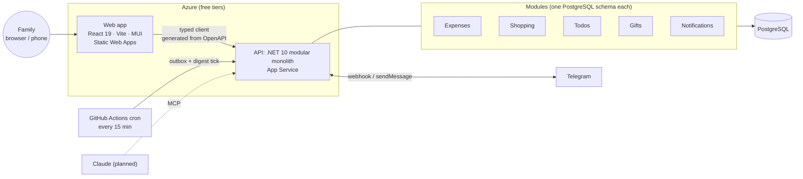

# Home

[](https://github.com/Weretik/home-app/actions/workflows/api.yml)
[](https://github.com/Weretik/home-app/actions/workflows/web.yml)


**A family service that replaced a set of Google Sheets and Apps Script Telegram bots with one app:** the household
budget with limits and a savings jar, a shared shopping list, to-dos, a gift wishlist and a family Telegram bot.
It runs in production on Azure for two people and costs $0 in hosting.

It is also a full-size example of how I build business systems: a .NET 10 modular monolith with a React front end,
a specification before every feature, architecture rules checked by tests in CI, and a typed contract between the
two halves. Next step: an MCP server, so the home can be managed from Claude.

## What it does

| Section | What replaced what |
| --- | --- |
| **Budget** | Expenses, incomes and the savings jar; monthly and quarterly spending limits with carry-over of overspend, planned expenses for the month forecast, and a computed month summary. Replaces the budget spreadsheet and its summary tabs. |
| **Shopping** | One live list for both phones: quick add from free text («milk, bread, eggs 10»), automatic store departments, a cart that empties itself, history and frequent items. |
| **To-dos** | Tasks for each person or both, with steps, statuses, priorities, categories and an archive. |
| **Gifts** | A wishlist with variants, an archive of what was given and personal details. A gift with a giver and a buy-by date becomes a to-do and closes itself when the to-do is done. |
| **Telegram bot** | Morning to-dos, gift reminders, the evening shopping list, weekly and monthly expenses summaries, «✅» buttons to close a task from the chat. |

## Architecture



- **Modular monolith.** One deployable API; each module (Expenses, Shopping, Todos, Gifts, Notifications) has five
  projects (`Api`, `Application`, `Contracts`, `Domain`, `Infrastructure`) and its own database schema. Modules talk
  only through their `Contracts`; there are no foreign keys across schemas.
- **Reliable side effects.** Telegram messages and cross-module events go through a transactional outbox; creates
  take an `Idempotency-Key`, edits use optimistic concurrency, so a repeated tap or retry never doubles a record.
- **Contract first.** `api/docs/contracts/openapi.json` is generated from the code on every build; CI fails if it
  drifts, and the web app's typed client is generated from it.
- **Every rule has a test.** Module boundaries, layer dependencies, folder sizes, endpoint metadata and naming are
  checked by architecture tests on the backend and structure checks on the frontend
  ([ADR 0029](api/docs/decisions/0029-every-rule-checked-by-a-test.md)). This is what keeps AI-assisted changes
  honest: an agent follows [AGENTS.md](AGENTS.md), and CI proves the result.
- **Specification before code.** Each feature starts as a backend and a frontend SDD, ends with an architecture
  audit, and every lasting decision is an ADR: 35 for the API, 13 for the web app, 5 for the repository.

More: [C4 diagrams](api/docs/architecture/c4.md), [backend architecture](api/docs/architecture/README.md),
[web architecture](web/docs/architecture.md).

## Delivery and hosting

- **CI/CD on GitHub Actions.** A pull request runs build, unit, architecture and integration tests (PostgreSQL in
  Testcontainers) and the frontend checks; `main` deploys. The API signs in to Azure through **OIDC**, with no stored
  passwords or publish profiles. Database migrations run as bundles in the deploy, then smoke tests read every
  section.
- **$0 hosting.** API on App Service F1, web on Static Web Apps Free. App Service F1 has no always-on background jobs,
  so a GitHub Actions cron is the app's clock for the outbox and the bot
  ([ADR 0034](api/docs/decisions/0034-scheduler-github-actions-cron.md)).
- **Tests:** 371 unit and 77 architecture tests on the backend plus integration tests against a real PostgreSQL;
  400 tests on the frontend.

## Stack

| Area | Technologies |
| --- | --- |
| Backend | C#, .NET 10, ASP.NET Core minimal APIs, EF Core, PostgreSQL, Mediator, FluentValidation |
| Frontend | React 19, TypeScript, Vite, Material UI, TanStack Query, openapi-fetch |
| Tests | xUnit, NetArchTest, Testcontainers, Vitest, Testing Library |
| Cloud and delivery | Azure App Service, Azure Static Web Apps, GitHub Actions, OIDC, Dependabot |
| Integrations | Telegram Bot API (webhook) |

## Roadmap

- [ ] **MCP server**: manage the home from Claude (add an expense, read the month summary, update the shopping list).
- [ ] **Telegram bot webhooks**: more commands to add and change records right from the chat.
- [ ] **Google sign-in**: until then writes are open and rate limited
  ([ADR 0015](api/docs/decisions/0015-expenses-open-until-identity.md)).

## Repository map

Built on [fullstack-modular-template](https://github.com/Weretik/fullstack-modular-template).

```
api/    .NET 10 modular monolith: BuildingBlocks, Host.Api, Modules/<Name>/ (five projects each), tests
web/    React single-page app: app/, platform/, features/, a client generated from the API's OpenAPI document
docs/   Repository-wide decisions and deployment
```

`api/` and `web/` know nothing about each other except one file: the OpenAPI document `api/docs/contracts/openapi.json`.
Each half has its own README, rules, decisions and workflow.

| | API | Web |
| --- | --- | --- |
| Start here | [api/README.md](api/README.md) | [web/README.md](web/README.md) |
| Architecture | [Modules, layers, rules](api/docs/architecture/README.md), [C4](api/docs/architecture/c4.md) | [Folders and data flow](web/docs/architecture.md) |
| Rules | [api/docs/rules.md](api/docs/rules.md) | [web/docs/rules.md](web/docs/rules.md) |
| Decisions | [api/docs/decisions](api/docs/decisions/README.md) | [web/docs/decisions](web/docs/decisions/README.md) |
| Specifications | [api/docs/specs](api/docs/specs/README.md) | [web/docs/specs](web/docs/specs/README.md) |

Repository-wide: [decisions](docs/decisions/README.md) (structure, hosting, database) and [deployment](docs/deploy.md).
Rules for AI agents: [AGENTS.md](AGENTS.md).

## Quick start

You need the .NET 10 SDK, Node.js 22 and Docker.

```bash
# 1. Database
cd api
docker compose up -d

# 2. API on http://localhost:5000 (OpenAPI at /openapi/v1.json in Development)
dotnet run --project src/Host/Host.Api

# 3. Web on http://localhost:5173 (in a second terminal)
cd web
cp .env.example .env.local
npm ci
npm run dev
```

## Author

Built by [Vitaliy Tsiupin](https://www.linkedin.com/in/vitaliythupin/), full-stack .NET + React developer. The same
approach runs in the production systems I build for businesses.

## License

[MIT](LICENSE) © 2026 Vitaliy Tsiupin. You may use, copy and change this code, also commercially, as long as the
copyright notice and the license text stay with every copy or substantial part of it.
