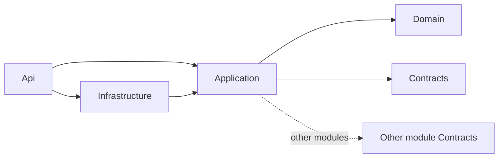

# Architecture

The backend is a **modular monolith**, built exactly like
[fullstack-modular-template](https://github.com/Weretik/fullstack-modular-template): one process, one database,
several modules that keep to themselves. Each module could become its own service later, but until there is a reason
to, one process is cheaper and simpler.

## Modules

The modules follow the areas of the old Google Sheets and Telegram bots. Each module has a page in
[../modules](../modules/expenses.md) once it exists:

| Module | Owns | Schema | Status |
| --- | --- | --- | --- |
| Expenses | Expenses, incomes, savings jar, categories, who paid, spending limits and the month summary; later plan, payments | `expenses` | in place, see [expenses.md](../modules/expenses.md) |
| Shopping | The shared shopping list | `shopping` | planned |
| Todos | To-dos for Masha, Vitaliy and both | `todos` | planned |
| Gifts | Gift wishlist | `gifts` | planned |
| Identity | The two user accounts and the session | `identity` | planned, see [ADR 0009](../decisions/README.md) |

Add a module as [the README](../../README.md#add-a-module) describes, then add it to this table, to
[c4.md](c4.md), and to `Program.cs` and `MediatorSetup.cs`. The architecture tests find modules by folder, so a new
module is covered as soon as it exists.

## Projects inside a module

| Project | Holds | May reference |
| --- | --- | --- |
| `Domain` | Aggregates, value objects, domain errors. No EF, no ASP.NET. | `BuildingBlocks.Domain` |
| `Application` | One folder per use case (command or query, validator, handler), ports such as `IShoppingDbContext` | own `Domain`, own `Contracts`, other modules' `Contracts`, `BuildingBlocks.Application` |
| `Infrastructure` | EF Core `DbContext`, configurations, migrations, seeding, adapters | own `Application`, `BuildingBlocks.Infrastructure` |
| `Api` | Minimal API endpoints and the module entry class `<Name>Module` | own `Application` and `Infrastructure`, `BuildingBlocks.Api`, other modules' `Contracts` |
| `Contracts` | What other modules may use: interfaces, DTOs, messages | nothing from other modules |

`Host.Api` only composes: it calls `Add<Name>Module` / `Map<Name>Module` for each module and sets up middleware,
OpenAPI, health and the outbox tick endpoint. It contains no business logic.

## Building blocks

| Project | Purpose |
| --- | --- |
| `BuildingBlocks.Domain` | `Result`, `Result<T>`, `Error`, `ErrorType`, `Entity<TId>`, `IAggregateRoot` |
| `BuildingBlocks.Application` | Validation and logging pipeline, paging and search helpers, outbox handler interface |
| `BuildingBlocks.Infrastructure` | `ModuleDbContext` (schema per module, unique-violation translation), outbox storage and dispatch, database health check |
| `BuildingBlocks.Api` | Error-to-problem mapping, global exception handler, rate limit policies, outbox tick endpoint, `/health` and `/api/system/status` |

Building blocks know nothing about any module. Something enters them only when at least three places need it.

## A request, end to end

For example `POST /api/shopping/items` once the Shopping module exists:

1. The endpoint in `Shopping.Api/Endpoints/Items/AddItemEndpoint.cs` binds its own `Request` record and sends an
   `AddItemCommand` through Mediator.
2. The pipeline logs the request and runs `AddItemValidator`. Invalid input stops here with a 400 problem listing the
   fields.
3. `AddItemHandler` asks the domain (`ShoppingItem.Create`) to apply the rules, adds the item and saves once. A rule
   failure returns a typed error.
4. The endpoint turns the result into `201 Created` or a problem response.

## Data

- One PostgreSQL database (`weretick` at the hosting provider, see
  [ADR 0003](../../../docs/decisions/0003-postgres-at-hosting-provider.md)), one schema per module, one migration
  history table per schema.
- No foreign keys between schemas; a module stores another module's ids as plain values.
- Reads use projections or `AsNoTracking` and page in SQL; there are no queries inside loops.
- Shared state has an explicit race guard: unique indexes, a row version (`xmin`) or a conditional `UPDATE`.

## Health

- `GET /health`: JSON with `status`, `version` (build version with the commit), `environment` and `checks`. Used by
  the deploy smoke test. Returns 503 when a check fails.
- `GET /api/system/status`: the same data as a documented operation (`getSystemStatus`), read by the web app through
  the typed client.
- The `database` check runs only when `ConnectionStrings:Database` is set.

## Security

- Authentication is not in place yet; it arrives with the Identity module and its ADR. The authentication and
  authorization middleware is already in the pipeline. Until then the Expenses reads and writes are
  anonymous; writes are rate limited ([ADR 0015](../decisions/0015-expenses-open-until-identity.md)).
- Edits of shared rows are guarded by a row version (`xmin`, `If-Match`)
  ([ADR 0017](../decisions/0017-row-version-via-xmin-for-edits.md)).
- The one-time sheet import needs the `X-Import-Key` header, compared in constant time, and is hidden from the
  OpenAPI document ([ADR 0014](../decisions/0014-one-time-sheet-import.md)).
- CORS allows only the origins in `Cors:Origins` (the web app), with credentials, ready for a cookie session.
- The outbox tick endpoint needs a shared key, compared in constant time, and is hidden from the OpenAPI document.
