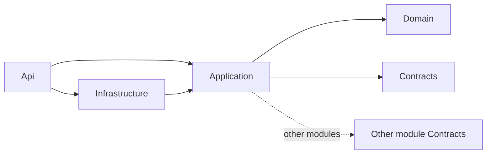

# Architecture

The backend is a **modular monolith**, built exactly like
[fullstack-modular-template](https://github.com/Weretik/fullstack-modular-template): one process, one database,
several modules that keep to themselves. Each module could become its own service later, but until there is a reason
to, one process is cheaper and simpler.

Every feature starts as a specification in [../specs](../specs/README.md) and ends with an architecture audit in
[../audits](../audits/); the [rules](../rules.md#enforcement) list the test that checks each rule, and the
[quality targets](quality-targets.md) give the numbers a design or an audit is measured against.

## Modules

The modules follow the areas of the old Google Sheets and Telegram bots. Each module has a page in
[../modules](../modules/expenses.md):

| Module | Owns | Schema | Status |
| --- | --- | --- | --- |
| Expenses | Expenses, incomes, savings jar, categories, who paid, spending limits with carry-over, planned expenses and the month summary; later payments | `expenses` | in place, see [expenses.md](../modules/expenses.md); specifications [001–005](../specs/README.md) |
| Shopping | The shared shopping list: items, cart and history (computed), departments, keywords, frequent items, summary | `shopping` | in place, see [shopping.md](../modules/shopping.md); specification [001](../specs/shopping/001-shopping-list/README.md) |
| Todos | To-dos for Masha, Vitaliy and both: tasks with steps, statuses, priorities, categories and the home page summary | `todos` | in place, see [todos.md](../modules/todos.md) |
| Gifts | Gift wishlist with variants, the archive of given gifts, gift categories, personal details and the home summary | `gifts` | in place, see [gifts.md](../modules/gifts.md); specification [001](../specs/gifts/001-gifts-module/README.md), [002](../specs/gifts/002-gift-purchase-todo/README.md) |
| Notifications | The family Telegram bot: linked chats, morning to-dos, gift reminders, evening shopping list, expenses summaries, the webhook and the scheduler tick | `notifications` | in place, see [notifications.md](../modules/notifications.md); specification [001](../specs/notifications/001-telegram-bot/README.md) |
| Identity | Google sign-in for Masha and Vitaliy (an e-mail allowlist), server sessions, the current member for other modules, the scheduler key scheme | `identity` | in place, see [identity.md](../modules/identity.md); [ADR 0037](../decisions/0037-google-sign-in-with-server-sessions.md) |
| Notes | What Masha and Vitaliy like, dislike and should know about each other, with note categories; the author comes from the session through `Identity.Contracts` | `notes` | in place, see [notes.md](../modules/notes.md); specification [001](../specs/notes/001-notes-module/README.md) |

Add a module as [the README](../../README.md#add-a-module) describes, then add it to this table, to
[c4.md](c4.md), and to `Program.cs` and `MediatorSetup.cs`. The architecture tests find modules by folder, so a new
module is covered as soon as it exists.

## Projects inside a module

| Project | Holds | May reference |
| --- | --- | --- |
| `Domain` | Aggregates, value objects, domain errors. No EF, no ASP.NET. | `BuildingBlocks.Domain` |
| `Application` | One folder per use case (command or query, validator, handler), ports such as `IShoppingDbContext` | own `Domain`, own `Contracts`, other modules' `Contracts`, `BuildingBlocks.Application` |
| `Infrastructure` | EF Core `DbContext`, configurations, migrations, seeding, adapters | own `Application`, `BuildingBlocks.Infrastructure` |
| `Api` | Minimal API endpoints and the module entry class `<Name>Module` | own `Application` and `Infrastructure`, `BuildingBlocks.Api`, other modules' `Contracts` |
| `Contracts` | What other modules may use: interfaces, DTOs, messages | nothing from other modules |

`Host.Api` only composes: it calls `Add<Name>Module` / `Map<Name>Module` for each module and sets up middleware,
OpenAPI, health and the outbox tick endpoint. It contains no business logic.

## Building blocks

| Project | Purpose |
| --- | --- |
| `BuildingBlocks.Domain` | `Result`, `Result<T>`, `Error`, `ErrorType`, `Entity<TId>`, `IAggregateRoot` |
| `BuildingBlocks.Application` | Validation and logging pipeline, paging and search helpers, outbox handler interface, `IOutboxPublisher` (publish an integration event in the same save) |
| `BuildingBlocks.Infrastructure` | `ModuleDbContext` (schema per module, unique-violation translation, `Publish` into the module's own outbox table), outbox storage and dispatch, database health check |
| `BuildingBlocks.Api` | Error-to-problem mapping, global exception handler, rate limit policies, outbox tick endpoint, `SchedulerKey` (the shared key check of both scheduler ticks), `/health` and `/api/system/status` |

Building blocks know nothing about any module. Something enters them only when at least three places need it.

## A request, end to end

For example `POST /api/shopping/items` once the Shopping module exists:

1. The endpoint in `Shopping.Api/Endpoints/Items/AddItemEndpoint.cs` binds its own `Request` record and sends an
   `AddItemCommand` through Mediator.
2. The pipeline logs the request and runs `AddItemValidator`. Invalid input stops here with a 400 problem listing the
   fields.
3. `AddItemHandler` asks the domain (`ShoppingItem.Create`) to apply the rules, adds the item and saves once. A rule
   failure returns a typed error.
4. The endpoint turns the result into `201 Created` or a problem response.

## Data

- One PostgreSQL database (`weretick` at the hosting provider, see
  [ADR 0003](../../../docs/decisions/0003-postgres-at-hosting-provider.md)), one schema per module, one migration
  history table per schema.
- No foreign keys between schemas; a module stores another module's ids as plain values.
- Reads use projections or `AsNoTracking` and page in SQL; there are no queries inside loops.
- Shared state has an explicit race guard: unique indexes, a row version (`xmin`) or a conditional `UPDATE`.

## Health

- `GET /health`: JSON with `status`, `version` (build version with the commit), `environment` and `checks`. Used by
  the deploy smoke test. Returns 503 when a check fails.
- `GET /api/system/status`: the same data as a documented operation (`getSystemStatus`), read by the web app through
  the typed client.
- The `database` check runs only when `ConnectionStrings:Database` is set.

## Security

- Sign-in with Google for the family, in the Identity module ([ADR 0037](../decisions/0037-google-sign-in-with-server-sessions.md),
  [module page](../modules/identity.md)): every endpoint needs a session (`Authorization: Bearer`) through the
  authorization fallback policy; the few anonymous endpoints say `AllowAnonymous` in their own file and are listed in
  `AuthorizationRulesTests`. A `GET` with the deploy check key (`X-Deploy-Check-Key`) reads as the read-only service `deploy-check`;
  the scheduler key reads nothing ([ADR 0045](../decisions/0045-separate-deploy-check-key.md)).
  The open period of [ADR 0015](../decisions/0015-expenses-open-until-identity.md) is over.
- Edits of shared rows are guarded by a row version (`xmin`, `If-Match`)
  ([ADR 0017](../decisions/0017-row-version-via-xmin-for-edits.md)).
- The one-time sheet import needs the `X-Import-Key` header, compared in constant time, and is hidden from the
  OpenAPI document ([ADR 0014](../decisions/0014-one-time-sheet-import.md)).
- CORS allows only the origins in `Cors:Origins` (the web app). The session travels in a header, not a cookie.
- The outbox tick and the notifications tick need the shared scheduler key (`X-Scheduler-Key`), compared in constant time,
  and are hidden from the OpenAPI document. They are called by cron-job.org, with the GitHub Actions cron as a backup
  ([ADR 0034](../decisions/0034-scheduler-github-actions-cron.md), [ADR 0043](../decisions/0043-external-cron-and-scheduler-heartbeat.md)). The key only runs the ticks.
- The Telegram webhook checks `X-Telegram-Bot-Api-Secret-Token`, derived from the bot token and compared in constant
  time; without a token it answers `404` ([ADR 0033](../decisions/0033-notifications-module-and-telegram-webhook.md)).
