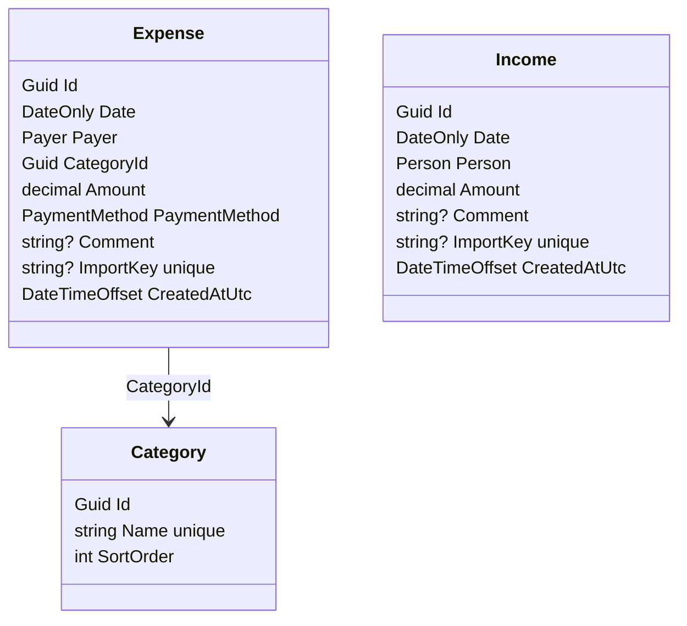

# Expenses module

The household's money: what Masha and Vitaliy spend and receive, by category and person. It replaces the Google Sheet
«Учёт расходов» (and its Telegram bot), whose history starts on 1 October 2026. The module was added in
[ADR 0013](../decisions/0013-expenses-module-model.md); its data came over from the sheet once, as
[ADR 0014](../decisions/0014-one-time-sheet-import.md) describes.

Code: [`src/Modules/Expenses`](../../src/Modules/Expenses). Schema: `expenses`.

## Model



| Concept | Meaning | In the old sheet |
| --- | --- | --- |
| `Expense` | Money spent on one day for one purpose. | a row of «Расходы» |
| `Income` | Money one person received. No categories. | a row of «Доходы» |
| `Category` | What an expense was for. Data, not an enum: the family renames, adds and merges categories. | «Справочник», column B |
| `Payer` | Whom an expense is booked to: `Vitaliy`, `Maria`, or `Shared` for household spending (groceries, home). | «Кто» in «Расходы» |
| `Person` | `Vitaliy` or `Maria`; who received an income. | «Кто» in «Доходы» |
| `PaymentMethod` | `Card` or `Cash`. | «Оплата» |

Rules (in `Expenses.Domain`, tested in `tests/UnitTests/Expenses`):

- An amount is hryvnias with kopecks: greater than zero, at most 10 000 000, at most two digits after the point.
  Stored as `numeric(12,2)`, never as a floating-point number.
- A date is a calendar day (`date`), between 2000-01-01 and 2100-12-31. Months are calendar months.
- A comment is trimmed, at most 500 characters; an empty comment is stored as `null`.
- Bank card numbers (`*6414`) are not modelled; they stay in the comment as they were in the sheet. Accounts and
  balances per card can come later as their own concept.
- Personal spending categories («Личные Виталий», «Личные Маша») are ordinary categories, as in the sheet. `Payer`
  says whose money it was, the category says what it was for.

## Layers

| Project | What is there |
| --- | --- |
| `Expenses.Domain` | `Categories/` (`Category`, errors), `Entries/` (`Expense`, `Income`, `PaymentMethod`, shared rules and errors), `Parties/` (`Payer`, `Person`). No EF Core, no ASP.NET Core. |
| `Expenses.Application` | `IExpensesDbContext` (the unit of work) and one folder per use case under `Features/`: `Categories/Queries/ListCategories`, `Expenses/Queries/ListExpenses`, `Incomes/Queries/ListIncomes`, `Imports/Commands/ImportSheet`. `Imports/SheetFormat/` reads the sheet's cells and makes import keys. |
| `Expenses.Infrastructure` | `ExpensesDbContext` (schema `expenses`), entity configurations and the category seed in `Persistence/`, migrations in `Persistence/Migrations/`, the development initializer that applies them. |
| `Expenses.Api` | `ExpensesModule` (`AddExpensesModule`, `MapExpensesModule`), endpoints in `Endpoints/Ledger/` and the operator import in `Endpoints/Import/`. |
| `Expenses.Contracts` | Empty: no other module uses Expenses yet. |

## Database

Schema `expenses`, migration history in `expenses.__ef_migrations_history`.

| Table | Columns | Indexes and keys |
| --- | --- | --- |
| `categories` | `id`, `name` (100), `sort_order` | `ux_categories_name` unique; 14 rows inserted by the `Initial` migration |
| `expenses` | `id`, `date`, `payer` (text enum), `category_id`, `amount` numeric(12,2), `payment_method` (text enum), `comment` (500), `import_key` (100), `created_at_utc` | `fk_expenses_categories` (restrict), `ix_expenses_date`, `ix_expenses_category_id`, `ux_expenses_import_key` unique where not null |
| `incomes` | `id`, `date`, `person` (text enum), `amount` numeric(12,2), `comment` (500), `import_key` (100), `created_at_utc` | `ix_incomes_date`, `ux_incomes_import_key` unique where not null |

Enums are stored as their names (`Shared`, `Card`) so the data reads without the code. Ids are UUID v7.

## HTTP API

All under `/api/expenses`, tag `Expenses`. Reads are open for now, see
[ADR 0015](../decisions/0015-expenses-open-until-identity.md).

| Operation | Route | Notes |
| --- | --- | --- |
| `listExpenses` | `GET /api/expenses?year&month&categoryId&payer&page&pageSize` | Newest first; `totalAmount` is the sum of the whole filtered month, not of the page. |
| `listIncomes` | `GET /api/expenses/incomes?year&month&person&page&pageSize` | Same shape as expenses. |
| `listExpenseCategories` | `GET /api/expenses/categories` | In `sortOrder`. |
| (hidden) | `POST /api/expenses/imports/sheet` | The one-time import below. Not in the OpenAPI document. |

`pageSize` is 1–100 (default 50), `month` 1–12, `year` 2000–2100.

## The one-time import from the sheet

The endpoint takes both tabs exactly as the Google Sheets API returns them (`values` of `Расходы!A1:F` and
`Доходы!A1:D`: rows of cell text, header first):

```json
{ "expenseRows": [["Дата","Кто","Категория","Сумма, грн","Оплата","Комментарий"], ["01.10.2026","Мария","Личные Маша","2,424.00","Карта","…"]],
  "incomeRows":  [["Дата","Кто","Сумма, грн","Комментарий"], ["06.10.2026","Мария","25,025.00","…"]] }
```

How it reads the sheet:

- The header must match, so a moved column cannot load amounts as dates.
- Dates `dd.MM.yyyy`; amounts `2,424.00` (comma for thousands, point for kopecks; any other format is rejected);
  «Виталий» / «Мария» (or «Маша») / «Общее»; «Карта» / «Наличные»; categories by name, case-insensitive.
- Empty rows are skipped. Any unreadable cell, unknown category or broken rule stops the whole import, and the
  answer lists every problem with its sheet row number (`400`, code `expenses.import_invalid_rows`).
- Each row gets an import key: a hash of its values plus its occurrence among identical rows (the sheet has real
  duplicates, such as two equal water bills on one day). Rows whose key is already stored are skipped, so the import
  can run again safely, and a row added to the sheet later is picked up by the next run.
- The answer reports rows added and skipped and the sums per month, to compare with the sheet's own totals.

How to run it (done once, on 2026-11-26 or later):

1. Set the App Service variable `Expenses__Import__Key` to a long random value. Without it the endpoint answers 404.
2. Read both tabs with the Sheets API (read-only) and send them with the header `X-Import-Key: <the value>`. The
   endpoint is rate limited like every anonymous write.
3. Compare the reported months with the sheet («Баланс по месяцам»), then delete `Expenses__Import__Key`.

## Pages

The sheet's tabs become pages of the Expenses section of the web app. Only the first two exist so far; each later
page arrives with its own use cases and model changes.

| Sheet tab | Page | Status |
| --- | --- | --- |
| Расходы | Расходы | list by month, filters by category and payer |
| Доходы | Доходы | list by month, filter by person |
| Сводка | Обзор | planned |
| Бюджет | Лимиты | planned (monthly and quarterly limits, overspend carried into the next period) |
| План | План | planned |
| Платежи | Платежи | planned (recurring mandatory payments) |
| Баланс по месяцам | По месяцам | planned |
| Копилка | Копилка | planned (card *8140 as savings) |
| Справочник | Категории | planned (managing categories) |
