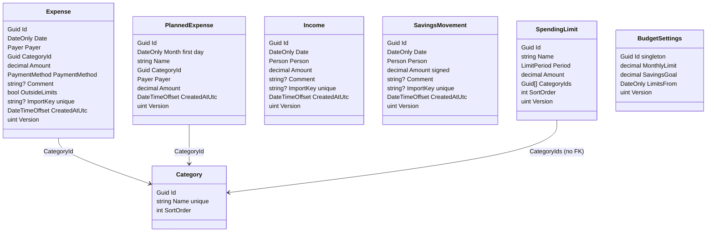

# Expenses module

The household's money: what Masha and Vitaliy spend, receive and put aside, by category and person. It replaces the
Google Sheet «Учёт расходов» (and its Telegram bot), whose history starts on 1 October 2026. The module was added in
[ADR 0013](../decisions/0013-expenses-module-model.md); its data came over from the sheet once, as
[ADR 0014](../decisions/0014-one-time-sheet-import.md) describes. Since then the entries are added and edited on the
site. The module also keeps the budget (spending limits, the monthly limit and the savings goal,
[ADR 0019](../decisions/0019-spending-limits-as-category-sets.md)) and computes a month's summary from the entries
([ADR 0020](../decisions/0020-month-summary-computed-on-read.md)), with overspend carried into the next period like the
sheet ([ADR 0027](../decisions/0027-limit-carry-over-like-the-sheet.md)) and a forecast from planned expenses
([ADR 0028](../decisions/0028-planned-expenses-for-the-forecast.md)).

Code: [`src/Modules/Expenses`](../../src/Modules/Expenses). Schema: `expenses`. Specifications (SDD), one per feature:
[001 entries and the sheet import](../specs/expenses/001-entries-and-sheet-import/README.md),
[002 savings jar](../specs/expenses/002-savings-jar/README.md),
[003 budget settings and limits](../specs/expenses/003-budget-settings-and-limits/README.md),
[004 month summary](../specs/expenses/004-month-summary/README.md),
[005 forecast, carry-over, outside limits](../specs/expenses/005-budget-forecast-carryover/README.md)
([index](../specs/README.md)).

## Model



| Concept | Meaning | In the old sheet |
| --- | --- | --- |
| `Expense` | Money spent on one day for one purpose. | a row of «Расходы» |
| `Expense.OutsideLimits` | «Не в лимиты»: a deliberate one-off spend above the limits. Counts in the month's totals, but in no limit, not in the monthly limit and not in the carry-over ([ADR 0027](../decisions/0027-limit-carry-over-like-the-sheet.md)). | none (the sheet had no such mark) |
| `PlannedExpense` | An expense expected in a month but not made yet: name, category, payer, amount. Counts toward its limits in the forecast; recorded as a real expense when paid ([ADR 0028](../decisions/0028-planned-expenses-for-the-forecast.md)). | «План / Факт / Прогноз» in «Сводка» |
| `Income` | Money one person received. No categories. | a row of «Доходы» |
| `SavingsMovement` | Money put into the savings jar («Копилка», card *8140) or taken out of it. The amount is signed: plus is a deposit, minus a withdrawal ([ADR 0018](../decisions/0018-savings-jar-as-signed-movements.md)). | a row of «Копилка» |
| `SavingsDirection` | `Deposit` or `Withdrawal`, derived from the sign; not stored. | the colour of the row |
| `Category` | What an expense was for. Data, not an enum: the family renames, adds and merges categories. | «Справочник», column B |
| `Payer` | Whom an expense is booked to: `Vitaliy`, `Maria`, or `Shared` for household spending (groceries, home). | «Кто» in «Расходы» |
| `Person` | `Vitaliy` or `Maria`; who received an income or moved money in the jar. | «Кто» in «Доходы» and «Копилка» |
| `PaymentMethod` | `Card` or `Cash`. | «Оплата» |
| `SpendingLimit` | How much may be spent on a named set of categories in a month or a quarter. Limits may overlap: one category can count towards several limits ([ADR 0019](../decisions/0019-spending-limits-as-category-sets.md)). | a row of «Бюджет» |
| `LimitPeriod` | `Month` or `Quarter`: the calendar month or calendar quarter a limit covers. | monthly and quarterly limits in «Бюджет» |
| `BudgetSettings` | The one row of budget numbers not tied to categories: `MonthlyLimit` on all expenses of a month and the `SavingsGoal` for the jar (`0` means none), and `LimitsFrom`, the day limits start carrying overspend. | the overall limit, the jar goal and «Справочник!H2» of the sheet |
| `LimitCarryOver` | The sheet's carry-over formula as a pure function (`Domain/Budget/`). | «Перенос с прошлого мес.» in «Бюджет» |
| `MonthSummary` | A read model, never stored: one month's incomes, expenses, result, jar, limit usage with carry-over and the forecast ([ADR 0020](../decisions/0020-month-summary-computed-on-read.md)). | «Сводка» and «Бюджет» |
| `Version` | The row version, PostgreSQL `xmin`; changes on every save ([ADR 0017](../decisions/0017-row-version-via-xmin-for-edits.md)). | none |

Rules (in `Expenses.Domain`, tested in `tests/UnitTests/Expenses`):

- An amount is hryvnias with kopecks: greater than zero, at most 10 000 000, at most two digits after the point.
  Stored as `numeric(12,2)`, never as a floating-point number.
- A savings amount follows the same rules for its absolute value, may be negative, and is never zero
  (`expenses.amount_zero`).
- The jar's balance is never stored: it is the sum of all movements, and a month's balances are sums up to its
  bounds. The balance may go below zero; the sheet allowed it too.
- A date is a calendar day (`date`), between 2000-01-01 and 2100-12-31. Months are calendar months.
- A comment is trimmed, at most 500 characters; an empty comment is stored as `null`.
- An edit replaces date, person or payer, category, amount, payment method, comment and (for an expense)
  `OutsideLimits` with the same checks as a create; the import key and creation time stay. `outsideLimits` is
  optional in the request and `false` when left out. A delete removes the row for good.
- Bank card numbers (`*6414`) are not modelled; they stay in the comment as they were in the sheet. Accounts and
  balances per card can come later as their own concept.
- Personal spending categories («Личные Виталий», «Личные Маша») are ordinary categories, as in the sheet. `Payer`
  says whose money it was, the category says what it was for.

Budget rules (`Domain/Budget/`):

- A spending limit has a name (trimmed, 1–100 characters), a period, an amount greater than zero with the usual money
  rules, and at least one category, each once. The categories must exist (`404` `expenses.category_not_found`);
  they are a `uuid[]` of the same schema without a foreign key, checked on create and edit.
- Limits may overlap. The seeded «Другое» counts ten categories, including «Кафе…», «Уходовые средства и косметика»
  and «Зоотовары», which also have limits of their own, exactly as in the sheet. A limit's spending is the sum of
  the expenses in its categories over its period, whoever paid.
- A `Month` limit covers the calendar month; a `Quarter` limit covers the calendar quarter that holds the month
  (January–March, April–June, …). Expenses marked `OutsideLimits` never count in a limit.
- A new limit goes to the end of the list (`SortOrder` of the last plus 10); an edit keeps its place.
- The monthly limit and the savings goal are amounts from 0 (0 means none) with the usual money rules
  (`expenses.budget_settings_invalid`). `LimitsFrom` is a day in 2000–2100 (`expenses.limits_from_out_of_range`),
  seeded 2026-11-01 like the sheet. There is exactly one settings row, created by the `Budget` migration.

Carry-over rules (`LimitCarryOver`, [ADR 0027](../decisions/0027-limit-carry-over-like-the-sheet.md)), exactly as
the sheet's «Перенос с прошлого мес.»:

- Periods are walked from the first counted one up to the period asked about: for a monthly limit the first month
  that starts on or after `LimitsFrom`, for a quarterly one the quarter that holds `LimitsFrom`. Earlier periods
  carry nothing, and their `carriedIn` and `carriesOut` are 0.
- `carry(first) = 0`, `carry(k+1) = max(0, carry(k) + spent(k) − amount)`. The current amount of the limit is used
  for past periods, as in the sheet. Unspent money never carries forward; it only pays off earlier overspend.
- For the period asked about: `carriedIn = carry`, `left = amount − spent − carriedIn`,
  `percent = round((spent + carriedIn) / amount × 100)`, `carriesOut = max(0, spent + carriedIn − amount)`, and
  `perDay` is computed from this `left`.
- `spent` never includes expenses marked `OutsideLimits`.
- The monthly limit on all expenses carries the same way over months, with every expense the limits count; with no
  monthly limit both figures are 0.

Planned expense rules (`Domain/Planning/`, [ADR 0028](../decisions/0028-planned-expenses-for-the-forecast.md)):

- A plan belongs to a month (stored as its first day; `expenses.planned_month_invalid` otherwise), has a name
  (trimmed, 1–100 characters, `expenses.planned_name_required`, `expenses.planned_name_too_long`), an existing
  category, a payer and an amount with the usual money rules. It has no «outside the limits» flag.
- Recording a plan creates an expense with the plan's payer, category and amount on the given date and payment
  method (counted in the limits), and deletes the plan in the same save.
- Plans never change the carry-over; they only show in the forecast.

Summary rules (`Features/Summary/`), as in «Сводка»:

- Incomes are summed by person, expenses by payer, both over the calendar month.
- `result` = incomes − expenses − the jar's net movement of the month (deposits minus withdrawals), so money put
  aside lowers the result and money taken out raises it.
- `savingsNet` is the month's net movement, `savingsBalance` the jar at the end of the month, `savingsGoal` the
  target from the settings.
- `monthlyLimit` comes from the settings; `daysLeft` counts the days to the end of the month including today, and is
  `null` for any month but the current one.
- `expenses`, `expensesByPayer`, `topCategories` and `result` count every expense, those marked `OutsideLimits`
  included; `outsideLimitsCount` and `outsideLimitsAmount` say how many of them the month has and their sum (the web
  shows them only when there are any).
- `carriedIn` and `carriesOut` are the monthly limit's carry-over (see above).
- Every limit gets a usage row: its period (`from`, `to`, both included), amount, spent, `carriedIn`, left (negative
  when overspent), percent (rounded), `perDay`, what may still be spent per day until the period ends (left divided
  by the days left including today, never below 0; `null` when the period is not running now), `carriesOut`, and
  `planned`, the planned expenses of its categories in the months of its period.
- `forecast`: `planned` (the month's planned expenses), `expectedExpenses` = expenses + planned, `expectedResult` =
  incomes − expectedExpenses − savingsNet, `expectedTotalLeft` = monthlyLimit − (expenses the limits count + planned)
  − carriedIn, or 0 when there is no monthly limit.
- "Today" is the date in `Europe/Kyiv`, so the per-day figures change at local midnight.
- The top five categories of the month by amount.
- Nothing is stored: every request sums the entries in SQL. The carry-over reads one grouped sum per category and
  month from the quarter that holds `LimitsFrom` up to the end of the month's quarter, then walks the periods in
  memory. The figures were checked against the sheet for November 2026, the first counted month (carry 0).

## Use cases

| Area | Commands | Queries |
| --- | --- | --- |
| `Features/Expenses` | `CreateExpense`, `UpdateExpense`, `DeleteExpense` | `ListExpenses` |
| `Features/Incomes` | `CreateIncome`, `UpdateIncome`, `DeleteIncome` | `ListIncomes` |
| `Features/Savings` | `CreateSavingsMovement`, `UpdateSavingsMovement`, `DeleteSavingsMovement` | `ListSavingsMovements`, `ListSavingsMonths` |
| `Features/Categories` | | `ListCategories` |
| `Features/Budget` | `CreateSpendingLimit`, `UpdateSpendingLimit`, `DeleteSpendingLimit`, `UpdateBudgetSettings` | `GetBudget` |
| `Features/Planned` | `CreatePlannedExpense`, `UpdatePlannedExpense`, `DeletePlannedExpense`, `RecordPlannedExpense` | `ListPlannedExpenses` |
| `Features/Summary` | | `GetMonthSummary` (its response records in `Summary/Report/`; the per-limit, carry and forecast arithmetic in `SummaryFigures`, unit-tested with a fixed day) |
| `Features/Imports` | `ImportSheet` | |

- `ListExpenses` takes either `year` and `month`, or `from` and `to` (dates, both included, at most 366 days, within
  2000–2100); any other combination answers `400`. The total is the sum of the whole filtered period.
- **Creates** take an `Idempotency-Key` ([ADR 0007](../decisions/0007-idempotency-key-for-creates.md)). The key,
  the kind (`expense`, `income`, `savings`, `limit`, `planned`), a SHA-256 fingerprint of the data and the new id are saved in
  `create_requests` in the same transaction as the row (`Application/Idempotency/`). The same key with the same data
  returns the first id; with other data, or for another kind, it answers `409` `expenses.idempotency_key_reused`; a
  racing copy hits the primary key and is answered like a repeat. One table serves all kinds, instead of a key
  column on each.
- **Edits** carry the version the person started from; a mismatch, or a row changed between reading and saving,
  answers `409` `expenses.changed_meanwhile` ([ADR 0017](../decisions/0017-row-version-via-xmin-for-edits.md)).
- An unknown id answers `404` (`expenses.expense_not_found`, `expenses.income_not_found`,
  `expenses.savings_movement_not_found`, `expenses.limit_not_found`, `expenses.planned_expense_not_found`); an unknown category `404`
  `expenses.category_not_found`.
- Edits of a spending limit and of the budget settings carry their version in `If-Match` like the entries; a limit
  delete needs none. The same holds for planned expenses; recording one also needs the plan's version in `If-Match`
  and takes no `Idempotency-Key` (a repeat finds the plan gone: `404`).

## Layers

| Project | What is there |
| --- | --- |
| `Expenses.Domain` | `Budget/` (`SpendingLimit`, `LimitPeriod`, `BudgetSettings`, `LimitCarryOver`, errors), `Planning/` (`PlannedExpense`, errors), `Categories/` (`Category`, errors), `Entries/` (`Expense`, `Income`, `PaymentMethod`, shared rules and errors), `Parties/` (`Payer`, `Person`), `Savings/` (`SavingsMovement`, `SavingsDirection`). No EF Core, no ASP.NET Core. |
| `Expenses.Application` | `IExpensesDbContext` (the unit of work), `Idempotency/` (`CreateRequest` and the repeat rules), `BudgetCategories` (checks that a limit's categories exist), and one folder per use case under `Features/` (table above). `Imports/SheetFormat/` reads the sheet's cells and makes import keys. |
| `Expenses.Infrastructure` | `ExpensesDbContext` (schema `expenses`); entity configurations in `Persistence/Entries/` (expenses, incomes, savings movements, planned expenses, create requests) and `Persistence/Reference/` (categories, spending limits, budget settings, with `CategorySeed` and `BudgetSeed`); migrations in `Persistence/Migrations/`; the development initializer that applies them. |
| `Expenses.Api` | `ExpensesModule` (`AddExpensesModule`, `MapExpensesModule`), endpoints in `Endpoints/Expenses/`, `Endpoints/Incomes/`, `Endpoints/Savings/`, `Endpoints/Budget/Overview/` (budget, settings, month summary), `Endpoints/Budget/Limits/`, `Endpoints/Planned/Plans/` (planned expense CRUD) and `Endpoints/Planned/Recording/`, the operator import in `Endpoints/Import/`, and `EntryVersionHeader` (reads `If-Match`). |
| `Expenses.Contracts` | Empty: no other module uses Expenses yet. |

## Database

Schema `expenses`, migration history in `expenses.__ef_migrations_history`. Migrations: `Initial`, `Savings`, `Budget`, `ForecastAndCarryOver`, `LimitSortOrderUnique`.

| Table | Columns | Indexes and keys |
| --- | --- | --- |
| `categories` | `id`, `name` (100), `sort_order` | `ux_categories_name` unique; 14 rows inserted by the `Initial` migration |
| `expenses` | `id`, `date`, `payer` (text enum), `category_id`, `amount` numeric(12,2), `payment_method` (text enum), `comment` (500), `outside_limits` bool not null default false, `import_key` (100), `created_at_utc` | `fk_expenses_categories` (restrict), `ix_expenses_date`, `ix_expenses_category_id`, `ux_expenses_import_key` unique where not null |
| `incomes` | `id`, `date`, `person` (text enum), `amount` numeric(12,2), `comment` (500), `import_key` (100), `created_at_utc` | `ix_incomes_date`, `ux_incomes_import_key` unique where not null |
| `savings_movements` | `id`, `date`, `person` (text enum), `amount` numeric(12,2), signed, `comment` (500), `import_key` (100), `created_at_utc` | `ix_savings_movements_date`, `ux_savings_movements_import_key` unique where not null |
| `create_requests` | `key` (100), `kind` (20), `fingerprint` (64, hex SHA-256), `entity_id`, `created_at_utc` | primary key `key` |
| `spending_limits` | `id`, `name` (100), `period` (text enum, 20), `amount` numeric(12,2), `category_ids` uuid[], `sort_order` | primary key `id`; `ux_spending_limits_sort_order` unique (the race guard of the list order: two limits added at once cannot share a place, the second answers `409` `expenses.limit_added_meanwhile`); no foreign key on `category_ids` (an array, checked in the handlers); 7 rows inserted by the `Budget` migration |
| `budget_settings` | `id`, `monthly_limit` numeric(12,2), `savings_goal` numeric(12,2), `limits_from` date not null default 2026-11-01 | primary key `id`; one row, inserted by the `Budget` migration; without it `getBudget` and `updateBudgetSettings` both answer `404` `expenses.budget_settings_not_found` (the summary reads the numbers as 0) |
| `planned_expenses` | `id`, `month` date (first day), `name` (100), `category_id`, `payer` (text enum), `amount` numeric(12,2), `created_at_utc` | `fk_planned_expenses_categories` (restrict), `ix_planned_expenses_month`, `ix_planned_expenses_category_id` |

Enums are stored as their names (`Shared`, `Card`, `Quarter`) so the data reads without the code. Ids are UUID v7
(the seeded limits and the settings row have fixed ids). `Version` on expenses, incomes, savings movements, planned
expenses, spending limits and budget settings is PostgreSQL's system column `xmin`, mapped as the row version: it has no column of its
own and costs no storage.

The `Budget` migration seeds the limits of the old «Бюджет» sheet with plain SQL (EF seed data cannot hold the array
column without reporting a model change on every build; the values are also in `BudgetSeed`):

| Limit | Period | Amount | Categories |
| --- | --- | --- | --- |
| Еда и быт | month | 15 000 | Продукты, Быт |
| Личные Виталий | month | 7 000 | Личные Виталий |
| Личные Маша | month | 13 000 | Личные Маша |
| Кафе, доставка, развлечения | month | 3 000 | Кафе, доставка, развлечения |
| Уход и косметика | quarter | 3 000 | Уходовые средства и косметика |
| Зоотовары | quarter | 2 500 | Зоотовары |
| Другое | month | 15 000 | Коммуналка, Кафе…, Здоровье, Одежда, Ремонт, Подарки, Уходовые средства и косметика, Зоотовары, Мебель и техника, Сдаваемая квартира |

and the settings: monthly limit 50 000, savings goal 100 000. Later changes are made on the «Настройки» page.

## HTTP API

All under `/api/expenses`, tag `Expenses`. Reads and writes need a signed-in member
([ADR 0037](../decisions/0037-google-sign-in-with-server-sessions.md)). Every write uses the `PublicWrite` rate limit (60
requests a minute per client address in `appsettings.json`) and can answer `429`.

| Operation | Route | Notes |
| --- | --- | --- |
| `listExpenses` | `GET /api/expenses?year&month&categoryId&payer&page&pageSize` or `GET /api/expenses?from&to&…` | One month, or a period `from`–`to` (both included, at most 366 days). Newest first; `totalAmount` is the sum of the whole filtered period, not of the page. Each item has its `version`. |
| `createExpense` | `POST /api/expenses` | Body `{ date, payer, categoryId, amount, paymentMethod, comment, outsideLimits? }`, header `Idempotency-Key`. `201` with `{ id }` and `Location`. |
| `updateExpense` | `PUT /api/expenses/{id}` | Header `If-Match: <version>`. `204`. |
| `deleteExpense` | `DELETE /api/expenses/{id}` | `204`. |
| `listIncomes` | `GET /api/expenses/incomes?year&month&person&page&pageSize` | Same shape as expenses. |
| `createIncome`, `updateIncome`, `deleteIncome` | `POST /api/expenses/incomes`, `PUT` and `DELETE /api/expenses/incomes/{id}` | As for expenses. |
| `listSavingsMovements` | `GET /api/expenses/savings?year&month&page&pageSize` | One month's movements, newest first, with `direction`, the month's `deposits` and `withdrawals` (both positive), `balanceAtStart`, `balanceAtEnd` and `currentBalance`. |
| `listSavingsMonths` | `GET /api/expenses/savings/months` | `currentBalance` and every month with movements, newest first: deposits, withdrawals and closing balance. |
| `createSavingsMovement`, `updateSavingsMovement`, `deleteSavingsMovement` | `POST /api/expenses/savings`, `PUT` and `DELETE /api/expenses/savings/{id}` | As for expenses; `amount` is signed and not zero. |
| `listExpenseCategories` | `GET /api/expenses/categories` | In `sortOrder`. |
| `getBudget` | `GET /api/expenses/budget` | The settings' `version`, `monthlyLimit`, `savingsGoal`, `limitsFrom`, and every limit in order with its `version`, `period` and `categoryIds`; `404` `expenses.budget_settings_not_found` when the settings row is missing. |
| `updateBudgetSettings` | `PUT /api/expenses/budget/settings` | Body `{ monthlyLimit, savingsGoal, limitsFrom? }` (`limitsFrom` left out: unchanged), header `If-Match: <version>`. `204`. |
| `createSpendingLimit` | `POST /api/expenses/budget/limits` | Body `{ name, period, amount, categoryIds }`, header `Idempotency-Key`. `201` with `{ id }`. |
| `updateSpendingLimit` | `PUT /api/expenses/budget/limits/{id}` | Same body, header `If-Match: <version>`. `204`. |
| `deleteSpendingLimit` | `DELETE /api/expenses/budget/limits/{id}` | `204`; the expenses stay. |
| `getMonthSummary` | `GET /api/expenses/summary?year&month` | The month's `MonthSummary`: `incomes` and `incomesByPerson`, `expenses` and `expensesByPayer`, `outsideLimitsCount`, `outsideLimitsAmount`, `monthlyLimit`, `carriedIn`, `carriesOut`, `daysLeft`, `result`, `savingsNet`, `savingsBalance`, `savingsGoal`, `limits` (usage per limit with `carriedIn`, `carriesOut`, `planned`), `topCategories` and `forecast` (`planned`, `expectedExpenses`, `expectedResult`, `expectedTotalLeft`). See the summary rules above. |
| `listPlannedExpenses` | `GET /api/expenses/planned?year&month` | `{ items, totalAmount }`, items by name: `id`, `version`, `year`, `month`, `name`, `categoryId`, `categoryName`, `payer`, `amount`. Not paged. |
| `createPlannedExpense` | `POST /api/expenses/planned` | Body `{ year, month, name, categoryId, payer, amount }`, header `Idempotency-Key`. `201` with `{ id }`. |
| `updatePlannedExpense` | `PUT /api/expenses/planned/{id}` | Same body, header `If-Match: <version>`. `204`. |
| `deletePlannedExpense` | `DELETE /api/expenses/planned/{id}` | `204`. |
| `recordPlannedExpense` | `POST /api/expenses/planned/{id}/record` | Body `{ date, paymentMethod, comment }`, header `If-Match: <version>` of the plan. `201` with the new expense's `{ id }` and its `Location`; the plan is gone. |
| (hidden) | `POST /api/expenses/imports/sheet` | The sheet import below. Not in the OpenAPI document. |

`pageSize` is 1–100 (default 50), `month` 1–12, `year` 2000–2100, `period` `Month` or `Quarter`. `If-Match` takes the item's `version` as is,
quoted or not (`W/` is ignored); without it an edit answers `400`.

## The one-time import from the sheet

The endpoint takes the tabs exactly as the Google Sheets API returns them (`values` of `Расходы!A1:F`,
`Доходы!A1:D` and, optionally, `Копилка!A1:D`: rows of cell text, header first):

```json
{ "expenseRows": [["Дата","Кто","Категория","Сумма, грн","Оплата","Комментарий"], ["01.10.2026","Мария","Личные Маша","2,424.00","Карта","…"]],
  "incomeRows":  [["Дата","Кто","Сумма, грн","Комментарий"], ["06.10.2026","Мария","25,025.00","…"]],
  "savingsRows": [["Дата","Кто","Сумма, грн (+ отложили, − взяли)","Комментарий"], ["12.10.2026","Виталий","-111.10","…"]] }
```

How it reads the sheet:

- The header must match, so a moved column cannot load amounts as dates. In the «Копилка» header a hyphen may stand
  for the typographic minus.
- Dates `dd.MM.yyyy`; amounts `2,424.00` (comma for thousands, point for kopecks; any other format is rejected);
  savings amounts may start with `-`, `−` or `+`; «Виталий» / «Мария» (or «Маша») / «Общее»; «Карта» /
  «Наличные»; categories by name, case-insensitive.
- Empty rows are skipped. Any unreadable cell, unknown category or broken rule stops the whole import, and the
  answer lists every problem with its sheet row number (`400`, code `expenses.import_invalid_rows`).
- Each row gets an import key (`sheet:expense:…`, `sheet:income:…`, `sheet:savings:…`): a hash of its values plus
  its occurrence among identical rows (the sheet has real duplicates, such as two equal water bills on one day).
  Rows whose key is already stored are skipped, so the import can run again safely, and a row added to the sheet
  later is picked up by the next run.
- The answer reports rows added and skipped per tab and the sums per month (expenses, incomes and the net savings
  movement), to compare with the sheet's own totals.

How the production data is loaded (expenses and incomes first, «Копилка» later the same way): the rows are
made by the import locally and moved to production as a SQL script, so no import key is ever set in production.

1. Run the API locally against a local database (`dotnet user-secrets` for `ConnectionStrings:Database` and
   `Expenses:Import:Key`). Read the tabs with the Sheets API (read-only) and send them to
   `POST /api/expenses/imports/sheet` with the header `X-Import-Key: <the value>`.
2. Compare the reported months with the sheet («Баланс по месяцам», the «Копилка» totals).
3. Dump the imported tables as inserts that skip rows already present, for example
   `pg_dump --data-only --inserts --on-conflict-do-nothing --table=expenses.savings_movements` (and
   `expenses.expenses`, `expenses.incomes` for the first load). The dump stays outside the repository.
4. Run the script against the production database in DBeaver. `ON CONFLICT DO NOTHING` together with the unique
   import keys makes a second run, or a row already imported, change nothing.

The production `Expenses__Import__Key` stays unset, so the endpoint answers 404 there. Should the import ever run
against production directly, set it for that run only and delete it afterwards.

## Pages

The sheet's tabs become pages of the Expenses section of the web app; each later page arrives with its own use cases
and model changes.

| Sheet tab | Page | Status |
| --- | --- | --- |
| Расходы | Расходы | list by month, filters by category and payer; add, edit, delete |
| Доходы | Доходы | list by month, filter by person; add, edit, delete |
| Копилка | Копилка | movements by month with balances, months overview; add, edit, delete |
| Сводка | the home page summaries (a switcher between sections) | the month's incomes, expenses, result, jar, limit usage with carry-over and the forecast (`getMonthSummary`) |
| Бюджет | Настройки | spending limits (add, edit, delete), the savings goal and the limits start day (`getBudget` and the budget writes); overspend carries into the next period like the sheet |
| «План / Факт / Прогноз» of Сводка | Прогноз | planned expenses by month; add, edit, delete, record as an expense |
| План | План | planned |
| Платежи | Платежи | planned (recurring mandatory payments) |
| Баланс по месяцам | По месяцам | planned |
| Справочник | Категории | planned (managing categories) |
