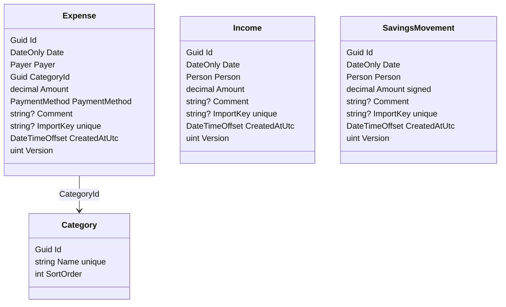

# Expenses module

The household's money: what Masha and Vitaliy spend, receive and put aside, by category and person. It replaces the
Google Sheet «Учёт расходов» (and its Telegram bot), whose history starts on 1 October 2026. The module was added in
[ADR 0013](../decisions/0013-expenses-module-model.md); its data came over from the sheet once, as
[ADR 0014](../decisions/0014-one-time-sheet-import.md) describes. Since then the entries are added and edited on the
site.

Code: [`src/Modules/Expenses`](../../src/Modules/Expenses). Schema: `expenses`.

## Model



| Concept | Meaning | In the old sheet |
| --- | --- | --- |
| `Expense` | Money spent on one day for one purpose. | a row of «Расходы» |
| `Income` | Money one person received. No categories. | a row of «Доходы» |
| `SavingsMovement` | Money put into the savings jar («Копилка», card *8140) or taken out of it. The amount is signed: plus is a deposit, minus a withdrawal ([ADR 0018](../decisions/0018-savings-jar-as-signed-movements.md)). | a row of «Копилка» |
| `SavingsDirection` | `Deposit` or `Withdrawal`, derived from the sign; not stored. | the colour of the row |
| `Category` | What an expense was for. Data, not an enum: the family renames, adds and merges categories. | «Справочник», column B |
| `Payer` | Whom an expense is booked to: `Vitaliy`, `Maria`, or `Shared` for household spending (groceries, home). | «Кто» in «Расходы» |
| `Person` | `Vitaliy` or `Maria`; who received an income or moved money in the jar. | «Кто» in «Доходы» and «Копилка» |
| `PaymentMethod` | `Card` or `Cash`. | «Оплата» |
| `Version` | The row version, PostgreSQL `xmin`; changes on every save ([ADR 0017](../decisions/0017-row-version-via-xmin-for-edits.md)). | none |

Rules (in `Expenses.Domain`, tested in `tests/UnitTests/Expenses`):

- An amount is hryvnias with kopecks: greater than zero, at most 10 000 000, at most two digits after the point.
  Stored as `numeric(12,2)`, never as a floating-point number.
- A savings amount follows the same rules for its absolute value, may be negative, and is never zero
  (`expenses.amount_zero`).
- The jar's balance is never stored: it is the sum of all movements, and a month's balances are sums up to its
  bounds. The balance may go below zero; the sheet allowed it too.
- A date is a calendar day (`date`), between 2000-01-01 and 2100-12-31. Months are calendar months.
- A comment is trimmed, at most 500 characters; an empty comment is stored as `null`.
- An edit replaces date, person or payer, category, amount, payment method and comment with the same checks as a
  create; the import key and creation time stay. A delete removes the row for good.
- Bank card numbers (`*6414`) are not modelled; they stay in the comment as they were in the sheet. Accounts and
  balances per card can come later as their own concept.
- Personal spending categories («Личные Виталий», «Личные Маша») are ordinary categories, as in the sheet. `Payer`
  says whose money it was, the category says what it was for.

## Use cases

| Area | Commands | Queries |
| --- | --- | --- |
| `Features/Expenses` | `CreateExpense`, `UpdateExpense`, `DeleteExpense` | `ListExpenses` |
| `Features/Incomes` | `CreateIncome`, `UpdateIncome`, `DeleteIncome` | `ListIncomes` |
| `Features/Savings` | `CreateSavingsMovement`, `UpdateSavingsMovement`, `DeleteSavingsMovement` | `ListSavingsMovements`, `ListSavingsMonths` |
| `Features/Categories` | | `ListCategories` |
| `Features/Imports` | `ImportSheet` | |

- **Creates** take an `Idempotency-Key` ([ADR 0007](../decisions/0007-idempotency-key-for-creates.md)). The key,
  the kind (`expense`, `income`, `savings`), a SHA-256 fingerprint of the data and the new id are saved in
  `create_requests` in the same transaction as the row (`Application/Idempotency/`). The same key with the same data
  returns the first id; with other data, or for another kind, it answers `409` `expenses.idempotency_key_reused`; a
  racing copy hits the primary key and is answered like a repeat. One table serves all three kinds, instead of a key
  column on each.
- **Edits** carry the version the person started from; a mismatch, or a row changed between reading and saving,
  answers `409` `expenses.changed_meanwhile` ([ADR 0017](../decisions/0017-row-version-via-xmin-for-edits.md)).
- An unknown id answers `404` (`expenses.expense_not_found`, `expenses.income_not_found`,
  `expenses.savings_movement_not_found`); an unknown category `404` `expenses.category_not_found`.

## Layers

| Project | What is there |
| --- | --- |
| `Expenses.Domain` | `Categories/` (`Category`, errors), `Entries/` (`Expense`, `Income`, `PaymentMethod`, shared rules and errors), `Parties/` (`Payer`, `Person`), `Savings/` (`SavingsMovement`, `SavingsDirection`). No EF Core, no ASP.NET Core. |
| `Expenses.Application` | `IExpensesDbContext` (the unit of work), `Idempotency/` (`CreateRequest` and the repeat rules), and one folder per use case under `Features/` (table above). `Imports/SheetFormat/` reads the sheet's cells and makes import keys. |
| `Expenses.Infrastructure` | `ExpensesDbContext` (schema `expenses`), entity configurations and the category seed in `Persistence/`, migrations in `Persistence/Migrations/`, the development initializer that applies them. |
| `Expenses.Api` | `ExpensesModule` (`AddExpensesModule`, `MapExpensesModule`), endpoints in `Endpoints/Expenses/`, `Endpoints/Incomes/`, `Endpoints/Savings/`, the operator import in `Endpoints/Import/`, and `EntryVersionHeader` (reads `If-Match`). |
| `Expenses.Contracts` | Empty: no other module uses Expenses yet. |

## Database

Schema `expenses`, migration history in `expenses.__ef_migrations_history`. Migrations: `Initial`, `Savings`.

| Table | Columns | Indexes and keys |
| --- | --- | --- |
| `categories` | `id`, `name` (100), `sort_order` | `ux_categories_name` unique; 14 rows inserted by the `Initial` migration |
| `expenses` | `id`, `date`, `payer` (text enum), `category_id`, `amount` numeric(12,2), `payment_method` (text enum), `comment` (500), `import_key` (100), `created_at_utc` | `fk_expenses_categories` (restrict), `ix_expenses_date`, `ix_expenses_category_id`, `ux_expenses_import_key` unique where not null |
| `incomes` | `id`, `date`, `person` (text enum), `amount` numeric(12,2), `comment` (500), `import_key` (100), `created_at_utc` | `ix_incomes_date`, `ux_incomes_import_key` unique where not null |
| `savings_movements` | `id`, `date`, `person` (text enum), `amount` numeric(12,2), signed, `comment` (500), `import_key` (100), `created_at_utc` | `ix_savings_movements_date`, `ux_savings_movements_import_key` unique where not null |
| `create_requests` | `key` (100), `kind` (20), `fingerprint` (64, hex SHA-256), `entity_id`, `created_at_utc` | primary key `key` |

Enums are stored as their names (`Shared`, `Card`) so the data reads without the code. Ids are UUID v7. `Version` on
expenses, incomes and savings movements is PostgreSQL's system column `xmin`, mapped as the row version: it has no
column of its own and costs no storage.

## HTTP API

All under `/api/expenses`, tag `Expenses`. Reads and writes are open without sign-in for now, see
[ADR 0015](../decisions/0015-expenses-open-until-identity.md). Every write uses the `PublicWrite` rate limit (60
requests a minute per client address in `appsettings.json`) and can answer `429`.

| Operation | Route | Notes |
| --- | --- | --- |
| `listExpenses` | `GET /api/expenses?year&month&categoryId&payer&page&pageSize` | Newest first; `totalAmount` is the sum of the whole filtered month, not of the page. Each item has its `version`. |
| `createExpense` | `POST /api/expenses` | Header `Idempotency-Key`. `201` with `{ id }` and `Location`. |
| `updateExpense` | `PUT /api/expenses/{id}` | Header `If-Match: <version>`. `204`. |
| `deleteExpense` | `DELETE /api/expenses/{id}` | `204`. |
| `listIncomes` | `GET /api/expenses/incomes?year&month&person&page&pageSize` | Same shape as expenses. |
| `createIncome`, `updateIncome`, `deleteIncome` | `POST /api/expenses/incomes`, `PUT` and `DELETE /api/expenses/incomes/{id}` | As for expenses. |
| `listSavingsMovements` | `GET /api/expenses/savings?year&month&page&pageSize` | One month's movements, newest first, with `direction`, the month's `deposits` and `withdrawals` (both positive), `balanceAtStart`, `balanceAtEnd` and `currentBalance`. |
| `listSavingsMonths` | `GET /api/expenses/savings/months` | `currentBalance` and every month with movements, newest first: deposits, withdrawals and closing balance. |
| `createSavingsMovement`, `updateSavingsMovement`, `deleteSavingsMovement` | `POST /api/expenses/savings`, `PUT` and `DELETE /api/expenses/savings/{id}` | As for expenses; `amount` is signed and not zero. |
| `listExpenseCategories` | `GET /api/expenses/categories` | In `sortOrder`. |
| (hidden) | `POST /api/expenses/imports/sheet` | The sheet import below. Not in the OpenAPI document. |

`pageSize` is 1–100 (default 50), `month` 1–12, `year` 2000–2100. `If-Match` takes the item's `version` as is,
quoted or not (`W/` is ignored); without it an edit answers `400`.

## The one-time import from the sheet

The endpoint takes the tabs exactly as the Google Sheets API returns them (`values` of `Расходы!A1:F`,
`Доходы!A1:D` and, optionally, `Копилка!A1:D`: rows of cell text, header first):

```json
{ "expenseRows": [["Дата","Кто","Категория","Сумма, грн","Оплата","Комментарий"], ["01.10.2026","Мария","Личные Маша","2,424.00","Карта","…"]],
  "incomeRows":  [["Дата","Кто","Сумма, грн","Комментарий"], ["06.10.2026","Мария","25,025.00","…"]],
  "savingsRows": [["Дата","Кто","Сумма, грн (+ отложили, − взяли)","Комментарий"], ["12.10.2026","Виталий","-111.10","…"]] }
```

How it reads the sheet:

- The header must match, so a moved column cannot load amounts as dates. In the «Копилка» header a hyphen may stand
  for the typographic minus.
- Dates `dd.MM.yyyy`; amounts `2,424.00` (comma for thousands, point for kopecks; any other format is rejected);
  savings amounts may start with `-`, `−` or `+`; «Виталий» / «Мария» (or «Маша») / «Общее»; «Карта» /
  «Наличные»; categories by name, case-insensitive.
- Empty rows are skipped. Any unreadable cell, unknown category or broken rule stops the whole import, and the
  answer lists every problem with its sheet row number (`400`, code `expenses.import_invalid_rows`).
- Each row gets an import key (`sheet:expense:…`, `sheet:income:…`, `sheet:savings:…`): a hash of its values plus
  its occurrence among identical rows (the sheet has real duplicates, such as two equal water bills on one day).
  Rows whose key is already stored are skipped, so the import can run again safely, and a row added to the sheet
  later is picked up by the next run.
- The answer reports rows added and skipped per tab and the sums per month (expenses, incomes and the net savings
  movement), to compare with the sheet's own totals.

How the production data is loaded (expenses and incomes first, «Копилка» later the same way): the rows are
made by the import locally and moved to production as a SQL script, so no import key is ever set in production.

1. Run the API locally against a local database (`dotnet user-secrets` for `ConnectionStrings:Database` and
   `Expenses:Import:Key`). Read the tabs with the Sheets API (read-only) and send them to
   `POST /api/expenses/imports/sheet` with the header `X-Import-Key: <the value>`.
2. Compare the reported months with the sheet («Баланс по месяцам», the «Копилка» totals).
3. Dump the imported tables as inserts that skip rows already present, for example
   `pg_dump --data-only --inserts --on-conflict-do-nothing --table=expenses.savings_movements` (and
   `expenses.expenses`, `expenses.incomes` for the first load). The dump stays outside the repository.
4. Run the script against the production database in DBeaver. `ON CONFLICT DO NOTHING` together with the unique
   import keys makes a second run, or a row already imported, change nothing.

The production `Expenses__Import__Key` stays unset, so the endpoint answers 404 there. Should the import ever run
against production directly, set it for that run only and delete it afterwards.

## Pages

The sheet's tabs become pages of the Expenses section of the web app; each later page arrives with its own use cases
and model changes.

| Sheet tab | Page | Status |
| --- | --- | --- |
| Расходы | Расходы | list by month, filters by category and payer; add, edit, delete |
| Доходы | Доходы | list by month, filter by person; add, edit, delete |
| Копилка | Копилка | movements by month with balances, months overview; add, edit, delete |
| Сводка | Обзор | planned |
| Бюджет | Лимиты | planned (monthly and quarterly limits, overspend carried into the next period) |
| План | План | planned |
| Платежи | Платежи | planned (recurring mandatory payments) |
| Баланс по месяцам | По месяцам | planned |
| Справочник | Категории | planned (managing categories) |
