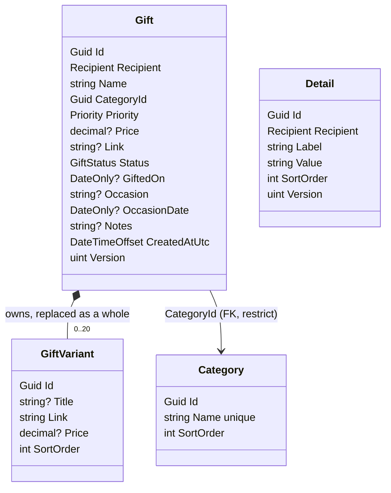

# Gifts module

The household's gift wishlist: ideas for Маша, Виталий or both («Вместе»), with variants, occasions and priorities,
an archive of what was given, the gift categories and the personal details («нюансы») such as ring or shoe size. It
replaces the Google Sheet «🎁 Список подарков». The module was added in
[ADR 0021](../decisions/0021-gifts-module-model.md); its data comes over once by a hand-run SQL script
([ADR 0026](../decisions/0026-gifts-import-as-sql-script.md)). Specification and audit:
[specs/gifts/001-gifts-module](../specs/gifts/001-gifts-module/README.md).

Code: [`src/Modules/Gifts`](../../src/Modules/Gifts). Schema: `gifts`.

## Model

| Concept | Meaning | In the old sheet |
| --- | --- | --- |
| `Gift` | One gift idea; the aggregate root. | a row |
| `GiftVariant` | Another shop or model of the same gift, with its own link ([ADR 0022](../decisions/0022-gift-variants-owned-by-gift.md)). | «Другие варианты» lines in the notes |
| `Recipient` | `Maria`, `Vitaliy` or `Together` (things for both or for the home). | «Для кого» |
| `Priority` | `High` («🔥 Очень хочу»), `Normal` («⭐ Хочу»), `Someday` («💭 Когда-нибудь»). | the priority column |
| `GiftStatus` | `Wanted` (the list), `Gifted` (given or bought), `Dropped` (no longer wanted); the last two are the archive ([ADR 0023](../decisions/0023-gifted-gifts-move-to-archive.md)). | «Куплено» greyed the row out |
| `Category` | What kind of gift; data edited in settings ([ADR 0024](../decisions/0024-gift-categories-as-editable-data.md)). | the category column |
| `Detail` | A labelled fact about a person, such as «Кольцо» = «18,5–19,0» ([ADR 0025](../decisions/0025-gift-details-as-reference-data.md)). | «нюансы» |
| `GiftsSummary` | A read model for the home page, never stored. | none |
| `Version` | PostgreSQL `xmin` ([ADR 0017](../decisions/0017-row-version-via-xmin-for-edits.md)). | none |

Rules (in `Gifts.Domain`, tested in `tests/UnitTests/Gifts`):

- A name is trimmed, 1–200 characters. The category must exist (`404` `gifts.category_not_found`).
- A price is optional (`null` = unknown); when present it is greater than 0, at most 10 000 000, with at most two
  digits after the point (`gifts.price_invalid`). The same for a variant's price.
- A link is an absolute `http` or `https` address of at most 2000 characters (`gifts.link_invalid`); empty means none.
- A gift has at most 20 variants (`gifts.too_many_variants`); each has a valid link, an optional title (trimmed,
  ≤ 200) and an optional price (`gifts.variant_invalid`). Create and update send the whole list; an update replaces it
  and gives the variants new ids.
- The occasion is trimmed, ≤ 100, empty means none; its date lies in 2000–2100. Notes are trimmed, ≤ 2000.
- A new gift is `Wanted`. An edit keeps the status and the gifted day. The status change sets `gifted_on` only for
  `Gifted`: the day sent, else the day it already had, else today in `Europe/Kyiv` (`gifts.gifted_on_out_of_range`
  outside 2000–2100); any other status clears it, and a `giftedOn` sent with it is ignored.
- A category name is trimmed, 1–100 and unique (`409` `gifts.category_name_taken`); a used category cannot be deleted
  (`409` `gifts.category_in_use`). A new category goes to the end (last sort order + 10).
- A detail has a label (1–100) and a value (1–200), both trimmed; a new one goes to the end of its recipient's list.

Summary rules (`Features/Summary/`):

- Per recipient (always `Maria`, `Vitaliy`, `Together`, in that order) and in `total`: `wantedCount`,
  `wantedPriceSum` (known prices only), `wantedWithoutPrice`, `highCount` (wanted `High`), `giftedCount` and
  `giftedPriceSum` (`Gifted` only). `Dropped` gifts count nowhere.
- `topWanted`: up to five wanted `High` gifts per recipient, in the active list's order.
- `upcoming`: up to five wanted gifts with an occasion date today (Kyiv) or later, nearest first.
- `details`: all details, by recipient then position.
- Computed on every request from one read of the non-dropped gifts and one of the details.

## Use cases

| Area | Commands | Queries |
| --- | --- | --- |
| `Features/Items` | `CreateGift`, `UpdateGift`, `DeleteGift`, `ChangeGiftStatus` | `ListGifts` |
| `Features/Categories` | `CreateCategory`, `RenameCategory`, `DeleteCategory` | `ListCategories` |
| `Features/Details` | `CreateDetail`, `UpdateDetail`, `DeleteDetail` | `ListDetails` |
| `Features/Summary` | | `GetGiftsSummary` (its response records in `Summary/Report/`) |

- **Creates** (gift, category, detail) take an `Idempotency-Key`; the key, the kind (`gift`, `category`, `detail`), a
  SHA-256 fingerprint and the new id are saved in `gifts.create_requests` in the same transaction
  (`Application/Idempotency/`, [ADR 0007](../decisions/0007-idempotency-key-for-creates.md)). Same key and data:
  the first id; other data or kind: `409` `gifts.idempotency_key_reused`; a racing copy is answered like a repeat.
- **Edits** of gifts and details and the **status change** carry the version in `If-Match`; a mismatch or a row changed
  meanwhile answers `409` `gifts.changed_meanwhile`, a missing version `400`. Category renames and all deletes carry
  none.
- Unknown ids answer `404` (`gifts.gift_not_found`, `gifts.category_not_found`, `gifts.detail_not_found`).

## Layers

| Project | What is there |
| --- | --- |
| `Gifts.Domain` | `Wishlist/` (`Gift`, `GiftVariant`, `VariantDraft`, `GiftStatus`, `Priority`, `GiftErrors`), `Categories/` (`Category`, errors), `People/` (`Recipient`, `Detail`, errors). No EF Core, no ASP.NET Core. |
| `Gifts.Application` | `IGiftsDbContext` (the unit of work), `HouseholdDay` (today in Kyiv), `Idempotency/`, and one folder per use case under `Features/` (table above); `Features/Items/VariantDraftValidator` (shared shape of a variant), `Features/Categories/CategoryNames` (the unique-name index). |
| `Gifts.Infrastructure` | `GiftsDbContext` (schema `gifts`; marks a gift modified when only its variants changed), configurations in `Persistence/Wishlist/` (gifts with owned variants, create requests) and `Persistence/Reference/` (categories with `CategorySeed`, details), migrations in `Persistence/Migrations/`, the development initializer. |
| `Gifts.Api` | `GiftsModule` (`AddGiftsModule`, `MapGiftsModule`), endpoints in `Endpoints/Items/`, `Endpoints/Status/` (status change and summary), `Endpoints/Categories/`, `Endpoints/Details/`, and `GiftVersionHeader` (reads `If-Match`). |
| `Gifts.Contracts` | Empty: no other module uses Gifts. |

## Database

Schema `gifts`, migration history in `gifts.__ef_migrations_history`. Migrations: `Initial`. The names are fixed:
the import SQL writes into them.

| Table | Columns | Indexes and keys |
| --- | --- | --- |
| `categories` | `id`, `name` (100), `sort_order` | `ux_categories_name` unique; 11 rows inserted by `Initial` |
| `gifts` | `id`, `recipient` (16), `name` (200), `category_id`, `priority` (16), `price` numeric(12,2) null, `link` (2000) null, `status` (16), `gifted_on` date null, `occasion` (100) null, `occasion_date` date null, `notes` (2000) null, `created_at_utc` timestamptz | `fk_gifts_categories` (restrict), `ix_gifts_category_id`, `ix_gifts_status` |
| `gift_variants` | `id`, `gift_id`, `title` (200) null, `link` (2000), `price` numeric(12,2) null, `sort_order` | `fk_gift_variants_gifts` (cascade), `ix_gift_variants_gift_id` |
| `details` | `id`, `recipient` (16), `label` (100), `value` (200), `sort_order` | `ix_details_recipient_sort_order` |
| `create_requests` | `key` (100), `kind` (20), `fingerprint` (64), `entity_id`, `created_at_utc` | primary key `key` |

Seeded categories (fixed ids, see `CategorySeed`): Техника 10, Дом и уют 20, Кухня 30, Мебель 40, Ванная 50, Одежда и
аксессуары 60, Украшения 70, Уход и здоровье 80, Спорт 90, Хобби и игры 100, Другое 110. `Version` of gifts and
details is `xmin`, without a column of its own.

## HTTP API

All under `/api/gifts`, tag `Gifts`, open without sign-in like Expenses
([ADR 0015](../decisions/0015-expenses-open-until-identity.md)). Every write uses the `PublicWrite` rate limit and can
answer `429`.

| Operation | Route | Notes |
| --- | --- | --- |
| `listGifts` | `GET /api/gifts/items?archived=false\|true` | `false` (default): `Wanted`, by priority, nearest occasion (none last), creation. `true`: `Gifted` and `Dropped`, latest `giftedOn` first (none last), then newest. Items carry `version`, `categoryName` and `variants`. Unpaged. |
| `createGift` | `POST /api/gifts/items` | Body `GiftRequest` (no status), header `Idempotency-Key`. `201` with `{ id }`. |
| `updateGift` | `PUT /api/gifts/items/{id}` | Same body, header `If-Match`. Keeps the status. `204`. |
| `deleteGift` | `DELETE /api/gifts/items/{id}` | With its variants. `204`. |
| `changeGiftStatus` | `PUT /api/gifts/items/{id}/status` | Body `{ status, giftedOn? }`, header `If-Match`. `204`. |
| `listGiftCategories` | `GET /api/gifts/categories` | In `sortOrder`. |
| `createGiftCategory` | `POST /api/gifts/categories` | Body `{ name }`, header `Idempotency-Key`. `201`. |
| `renameGiftCategory` | `PUT /api/gifts/categories/{id}` | Body `{ name }`. `204`. |
| `deleteGiftCategory` | `DELETE /api/gifts/categories/{id}` | `409` while used. `204`. |
| `listGiftDetails` | `GET /api/gifts/details` | By recipient (Maria, Vitaliy, Together), then position; each with `version`. |
| `createGiftDetail` | `POST /api/gifts/details` | Body `{ recipient, label, value }`, header `Idempotency-Key`. `201`. |
| `updateGiftDetail` | `PUT /api/gifts/details/{id}` | Same body, header `If-Match`. `204`. |
| `deleteGiftDetail` | `DELETE /api/gifts/details/{id}` | `204`. |
| `getGiftsSummary` | `GET /api/gifts/summary` | `recipients` (`recipient`, `counts`, `topWanted`), `total`, `upcoming`, `details`. See the summary rules. |

`GiftRequest` is `{ recipient, name, categoryId, priority, price?, link?, occasion?, occasionDate?, notes?, variants:
[{ title?, link, price? }] }`. Schema names start with `Gift`/`Gifts` (`GiftCategoryItem`, `GiftDetailItem`,
`CreatedGiftsEntry` …), since two modules' types with one name would merge into one OpenAPI schema; an architecture
test (`ContractSchemaNameTests`) keeps them apart.

## The one-time import

There is no import endpoint. The coordinator runs an SQL script by hand after the deploy that applies `Initial`: fixed
ids, the seeded category ids, `ON CONFLICT DO NOTHING` on every insert, variants parsed from the notes' «Другие
варианты» lines ([ADR 0026](../decisions/0026-gifts-import-as-sql-script.md)). The script stays outside the repository.

## Tests

- Unit: `tests/UnitTests/Gifts/Domain` (gift rules, variants, status and the Kyiv day, categories and details) and
  `tests/UnitTests/Gifts/Input` (validators): `dotnet test tests/UnitTests --filter "FullyQualifiedName~UnitTests.Gifts"`.
- Integration (PostgreSQL): `tests/IntegrationTests/Api/Gifts` (`GiftsApiTests`, `GiftsSettingsApiTests`):
  `dotnet test tests/IntegrationTests --filter "FullyQualifiedName~Gifts"`.
- Architecture: covered by every test in `tests/ArchitectureTests`, which find the module by its folder.
