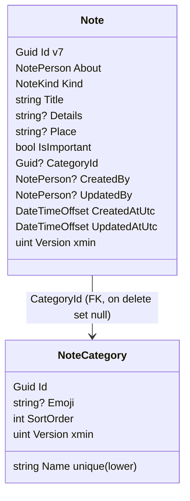

# Notes module

What Masha and Vitaliy like, dislike and should know about each other: «Маша любить півонії», «не любить молоко з
АТБ, але любить з Агромолу», «Віталій не любить томатний сік». Either of them adds, edits and deletes notes about
themselves or about the other; everything is shared between the two. The module was added in
[ADR 0039](../decisions/0039-notes-module-model.md) from the specification
[specs/notes/001-notes-module](../specs/notes/001-notes-module/README.md); who wrote a note comes from the Identity
module through [ADR 0040](../decisions/0040-current-member-through-identity-contracts.md).

Code: [`src/Modules/Notes`](../../src/Modules/Notes). Schema: `notes`.

## Model

- `Note` and `NoteCategory` are separate aggregates. A like and a dislike of the same thing in different shops are two
  notes, so a note stays one statement.
- Enums, stored as text: `NotePerson` `Vitaliy` · `Maria` (whom the note is about, who wrote it, who changed it last);
  `NoteKind` `Likes` (Любить) · `Dislikes` (Не любить) · `Fact` (Факт).
- `CreatedBy` and `UpdatedBy` are set by the server from the signed-in member (`Identity.Contracts.ICurrentMember`,
  mapped to `NotePerson` in `Features/Notes/NoteAuthors`); a new note has its author as the last editor too. Both are
  `null` for an allowlisted member who is neither Vitaliy nor Maria.

## Rules

| Rule | Error |
| --- | --- |
| A title is trimmed, 1–200 characters (R-003). | `400` `notes.title_invalid` |
| A description is trimmed, at most 2000 characters; empty is stored as `null` (R-004). | `400` `notes.details_too_long` |
| A place or brand is trimmed, at most 200 characters; empty is stored as `null` (R-005). | `400` `notes.place_too_long` |
| A category, when given, must exist; deleting a category keeps its notes, without one (R-006). | `404` `notes.category_not_found` |
| The author and the last editor come from the session; a request cannot set them (R-008). | — |
| Edits and deletes send the version in `If-Match`; a stale one answers `409` (R-009). | `409` `notes.changed_meanwhile`; `404` `notes.note_not_found` |
| A note create takes an `Idempotency-Key`: the same key and body return the first id, another body answers `409` (R-010). Category creates take none: a repeat hits the unique name. | `409` `notes.idempotency_key_reused` |
| A category name is trimmed, 1–50 characters, unique without regard to case; an optional emoji is at most 8 characters. A new category goes to the end (last `SortOrder` + 10) (R-011). | `400` `notes.category_name_invalid`, `notes.category_emoji_too_long`; `409` `notes.category_name_taken` |

List (R-012, R-013): one query, at most 1000 notes, no paging. Order: category `SortOrder` (notes without a category
last), important first, then the kind (Likes, Dislikes, Fact; ranked in SQL since it is stored as text), then
`lower(title)`. Filters: `about`, `kind` (repeatable), `categoryId` or `withoutCategory` (not both, `400`), `search`:
each word is an escaped `LIKE` on `lower(title)`, `lower(details)` or `lower(place)` (`SearchPattern`), every word
must match. No trigram index: the host forbids `pg_trgm` and the table holds hundreds of rows (ADR 0039).

## Use cases

| Area | Commands | Queries |
| --- | --- | --- |
| `Features/Notes` | `CreateNote`, `UpdateNote`, `DeleteNote` | `ListNotes` (projection, join and order in `ListNotes/NoteRows`) |
| `Features/Categories` | `CreateNoteCategory`, `UpdateNoteCategory`, `DeleteNoteCategory` | `ListNoteCategories` |

## Layers

| Project | What is there |
| --- | --- |
| `Notes.Domain` | `Notes/` (`Note`, `NoteKind`, `NotePerson`, `NoteErrors`), `Categories/` (`NoteCategory`, `CategoryErrors`). No EF Core, no ASP.NET Core. |
| `Notes.Application` | `INotesDbContext` (the unit of work), `Idempotency/` (`CreateRequest`, `NoteCreated`, the repeat rules), `Features/Notes/NoteAuthors` (the signed-in member's person), one folder per use case under `Features/`. References `Identity.Contracts` and no other module. |
| `Notes.Infrastructure` | `NotesDbContext` (schema `notes`); configurations in `Persistence/Notes/` (notes, create requests) and `Persistence/Categories/` (categories, `CategorySeed`); migrations in `Persistence/Migrations/`; the development initializer. |
| `Notes.Api` | `NotesModule` (`AddNotesModule`, `MapNotesModule`), endpoints in `Endpoints/Notes/` and `Endpoints/Categories/`, `NoteVersionHeader` (reads `If-Match`). |
| `Notes.Contracts` | Empty: no other module uses Notes yet. |

## Database

Schema `notes`, migration history in `notes.__ef_migrations_history`. Migration: `Initial` (adds the schema only, so
the previous release keeps working).

| Table | Columns | Indexes and keys |
| --- | --- | --- |
| `notes` | `id uuid`, `about varchar(16)`, `kind varchar(16)`, `title varchar(200)`, `details varchar(2000) null`, `place varchar(200) null`, `is_important boolean`, `category_id uuid null`, `created_by varchar(16) null`, `updated_by varchar(16) null`, `created_at_utc timestamptz`, `updated_at_utc timestamptz`, `xmin` (version) | `PK_notes`; `fk_notes_categories` → `categories(id)` `ON DELETE SET NULL`; `ix_notes_about_kind`; `ix_notes_category_id` |
| `categories` | `id uuid`, `name varchar(50)`, `emoji varchar(8) null`, `sort_order integer`, `xmin` | `PK_categories`; `ux_categories_lower_name` (unique on `lower(name)`, created in SQL) |
| `create_requests` | `key varchar(100)`, `kind varchar(20)` (`note`), `fingerprint varchar(64)`, `entity_id uuid`, `created_at_utc timestamptz` | `PK_create_requests` on `key` |

Seeded categories (fixed ids, `CategorySeed`):

| Id | Emoji | Name | Sort |
| --- | --- | --- | --- |
| `019ac3a0-0000-7000-8000-000000000010` | 🍲 | Їжа | 10 |
| `019ac3a0-0000-7000-8000-000000000020` | 🥤 | Напої | 20 |
| `019ac3a0-0000-7000-8000-000000000030` | 💐 | Квіти | 30 |
| `019ac3a0-0000-7000-8000-000000000040` | 💻 | Техніка | 40 |
| `019ac3a0-0000-7000-8000-000000000050` | 👕 | Одяг | 50 |
| `019ac3a0-0000-7000-8000-000000000060` | 🎬 | Дозвілля | 60 |
| `019ac3a0-0000-7000-8000-000000000070` | ✈️ | Подорожі | 70 |
| `019ac3a0-0000-7000-8000-000000000080` | 🩺 | Здоров'я | 80 |
| `019ac3a0-0000-7000-8000-000000000090` | 🏠 | Дім | 90 |
| `019ac3a0-0000-7000-8000-000000000100` | 📝 | Інше | 100 |

The deploy workflow builds a `notes` migrations bundle with the other modules' and runs it before the new version
starts ([ADR 0016](../decisions/0016-migrations-as-bundles-in-deploy.md)); the smoke step then reads
`GET /api/notes/items` and `GET /api/notes/categories` with the deploy check key.

## HTTP API

Group `/api/notes`, tag `Notes`. Every endpoint needs a signed-in member (ADR 0037) and lists `401`; the deploy check key
only reads. Every write uses the `PublicWrite` rate limit and lists `429`.

| Operation | Method and path | Request | Response |
| --- | --- | --- | --- |
| `listNotes` | `GET /items` | query `about` (`Vitaliy`/`Maria`), `kind` (repeatable), `categoryId`, `withoutCategory`, `search` | `200 NoteItem[]`, `400` |
| `createNote` | `POST /items` | `Idempotency-Key`; `NoteRequest` (`about`, `kind`, `title`, `details?`, `place?`, `categoryId?`, `isImportant`) | `201 NoteCreated`, `400`, `404`, `409` |
| `updateNote` | `PUT /items/{id}` | `If-Match`; `NoteRequest` | `204`, `400`, `404`, `409` |
| `deleteNote` | `DELETE /items/{id}` | `If-Match` | `204`, `404`, `409` |
| `listNoteCategories` | `GET /categories` | | `200 NoteCategoryItem[]` (`id`, `name`, `emoji`, `sortOrder`, `version`, `noteCount`) |
| `createNoteCategory` | `POST /categories` | `NoteCategoryRequest` (`name`, `emoji?`) | `201 NoteCreated`, `400`, `409` |
| `updateNoteCategory` | `PUT /categories/{id}` | `If-Match`; `NoteCategoryRequest` | `204`, `400`, `404`, `409` |
| `deleteNoteCategory` | `DELETE /categories/{id}` | `If-Match` | `204`, `404`, `409` |

`NoteItem`: `id`, `about`, `kind`, `title`, `details`, `place`, `isImportant`, `categoryId`, `categoryName`,
`categoryEmoji`, `createdBy`, `updatedBy`, `createdAtUtc`, `updatedAtUtc`, `version`. `If-Match` takes the `version`
quoted or not; a missing header is a `400`.

## Tests

- Unit (`tests/UnitTests/Notes`): note and category rules, validators, the author mapping (`NoteAuthors`);
  `tests/UnitTests/Identity/CurrentMemberTests` for `ICurrentMember`.
- Architecture: the module is found by folder like every module; `ModuleBoundaryTests.Only_TheIdentityModule_ReadsClaims`
  keeps claims and `HttpContext.User` out of every module but Identity (ADR 0040).
- Integration (`tests/IntegrationTests/Api/Notes`): the author from the session (Vitaliy and Masha), the last editor,
  `409` on a stale edit or delete, repeats with the same key, list order, filters, the word search, categories (seed,
  unique names, rename, delete keeps notes), the rate limit on every write, `401` without a session, the deploy check key
  reads but cannot write, and the indexes the migration creates. `IdentityProtectionApiTests` covers both reads too,
  since it walks every `GET` of the contract.
