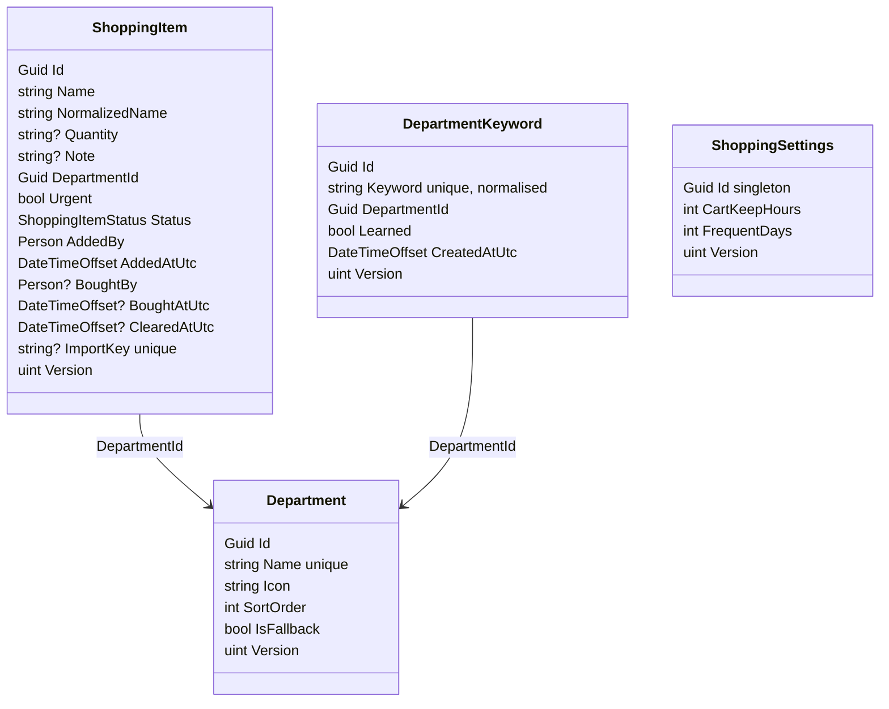

# Shopping module

The shared shopping list of Masha and Vitaliy. It replaces the Google Sheet «🛒 Список покупок» and its Telegram bot
(«молоко, хлеб, яйца 10» in a chat) and keeps everything the bot did: quick add from text with automatic
departments, ticking items off in the shop, a cart that empties itself, history and «⭐ Частые». On top it has notes,
«Срочно», editable departments and keywords, a history page and a summary for the home page. The module was added in
[ADR 0031](../decisions/0031-shopping-module-model.md); text parsing and department matching are
[ADR 0032](../decisions/0032-text-parsing-and-department-matching.md). Specifications:
[specs/shopping/001-shopping-list](../specs/shopping/001-shopping-list/README.md),
[002-name-suggestions](../specs/shopping/002-name-suggestions/README.md) (names suggested while typing).

Code: [`src/Modules/Shopping`](../../src/Modules/Shopping). Schema: `shopping`.

## Model

| Concept | Meaning | In the old sheet / bot |
| --- | --- | --- |
| `ShoppingItem` | One thing to buy. In the list while needed or in the cart, then history. | a row of «Список», later «История» |
| `ShoppingItemStatus` | `Needed` or `Bought`. Cart or history is computed (`CartWindow`), never stored. | «Статус» Нужно / Куплено |
| `Person` | `Vitaliy` or `Maria`: who added and who bought. The module's own copy of the Expenses enum (same names, so the OpenAPI document has one `Person` schema). | «Кто добавил», «Кто купил» |
| `Department` | A part of the store with an emoji, in store-walk order. Exactly one, «Другое», is the fallback and cannot be deleted. | «Справочник», column A |
| `DepartmentKeyword` | A normalised word start, or several («зубн паст»), pointing to a department. `Learned` when it came from moving an item. | «Справочник», columns C:D |
| `ShoppingSettings` | `CartKeepHours` (1–72, default 3) and `FrequentDays` (30–730, default 183). One row. | constants of the bot |
| `Version` | PostgreSQL `xmin` ([ADR 0017](../decisions/0017-row-version-via-xmin-for-edits.md)). | none |

Rules (in `Shopping.Domain`, tested in `tests/UnitTests/Shopping`):

- **Text** (`Parsing/ItemTextParser`, the bot's `parseItems_`): split on `,`, `;` and new lines; leading bullets and
  dashes and trailing dots, `!` and spaces are trimmed. A quantity is a number at the end (optionally after `-`,
  `–`, `—`, `:` or `x`/`х`/`×`) or at the start, with an optional unit from the bot's list (`шт`, `кг`, `г`, `гр`,
  `л`, `мл`, `уп`, `упак…`, `пач…`, `бут…`, `бан…`, `пак…`, `кило…`, `грам…`, `литр…`, `десят…`, `ящ…`,
  `рулон…`); it is kept as typed (`300 г`), at most 30 characters. The name is cut to 80 characters and starts with
  a capital letter. Only ASCII digits count; a decimal comma splits the text like any comma, as in the bot. 1–50
  items per add, text up to 1000 characters.
- **Names compare normalised** (`Parsing/NameNormalizer`, the bot's `norm_`): lower case, `ё` → `е`, spaces
  collapsed and trimmed.
- **Department** (`Matching/DepartmentMatcher`, the bot's `deptOf_`): a keyword equal to the whole normalised name
  scores 1000; otherwise it matches when each of its words starts some word of the name and scores its length. The
  best score wins; on a tie the department earlier in store order (then the alphabetically first keyword). No match →
  the fallback. A department chosen in the add form overrides matching for that add.
- **Re-add**: the same name needed → kept, quantity replaced when given, «Срочно» switched on when asked; the same
  name in the cart → needed again, added now by this person; otherwise a new row. A re-added item keeps its
  department: a department chosen in the add form applies only to new rows.
- **List / cart / history** (`Items/CartWindow`): in the list = needed, or bought, not cleared and bought less than
  `CartKeepHours` ago. Everything else bought is history. «Убрать купленные» sets `ClearedAtUtc` on everything in
  the cart.
- **Status** is set, not toggled: `Bought` records the first buyer and time; `Needed` clears them. A history item
  cannot change status or be edited (`404 shopping.item_not_found`); «Вернуть в список» is an ordinary add.
- **Learning**: an edit that moves an item to another, non-fallback department makes its normalised name (if 2–60
  characters) a learned keyword of that department; an existing keyword with that text moves there.
- **Departments**: name 1–40 (unique), icon up to 8 characters. A new one goes just before the fallback. Deleting one
  moves its items (list and history) and keywords to the fallback. The order is set by sending every id once.
- **Keywords**: stored normalised, 2–60 characters, unique.
- **Suggestions** (`ListSuggestions`): the query is normalised like names (1–80 characters, `limit` 1–20, default 8);
  a name matches when its normalised form or one of its words starts with it (escaped `LIKE`,
  `SearchPattern.StartsWith` / `WordStartsWith`). All rows count (list, cart, history), one suggestion per normalised
  name, in the spelling and department of the row added last; `timesBought` counts its `Bought` rows, `inList` says
  whether a row of it is in the list now. Order: names starting with the query, then the most bought, then the most
  recently added, then alphabetically.

## Use cases

| Area | Commands | Queries |
| --- | --- | --- |
| `Features/Items` | `AddItems`, `UpdateItem`, `SetItemStatus`, `DeleteItem`, `ClearCart` | `ListItems`, `ListHistory`, `ListFrequent`, `ListSuggestions`, `GetSummary` |
| `Features/Departments` | `CreateDepartment`, `UpdateDepartment`, `DeleteDepartment`, `ReorderDepartments` | `ListDepartments`, `MatchDepartment` |
| `Features/Keywords` | `CreateKeyword`, `UpdateKeyword`, `DeleteKeyword` | `ListKeywords` |
| `Features/Settings` | `UpdateSettings` | `GetSettings` |

Shared read helpers: `Features/Items/Views/` (the item view, the item–department join, "now" with the cart cutoff,
frequent statistics) and `Features/Dictionary/` (the matcher loaded in store order, keyword learning).

- **Creates** (`AddItems`, `CreateDepartment`, `CreateKeyword`) take an `Idempotency-Key`
  ([ADR 0007](../decisions/0007-idempotency-key-for-creates.md)), stored in `shopping.create_requests` with a
  fingerprint and the outcome as JSON (the ids an add created, restored and updated), in the same transaction. A
  repeat answers from the outcome (re-reading the items); other data with the same key is `409
  shopping.idempotency_key_reused`.
- **Edits and deletes** of items, departments, keywords and settings carry `If-Match: <version>`; a mismatch is `409
  shopping.changed_meanwhile`. Setting a status and reordering need no version (target values; concurrent saves
  still meet the row version and answer 409).
- `DeleteDepartment` is the one command with an explicit transaction: two set-based `UPDATE`s move the rows, then the
  department is deleted. `ClearCart` is one conditional `UPDATE`.
- "Now" comes from `TimeProvider`, cut to microseconds (PostgreSQL's precision).

## Layers

| Project | What is there |
| --- | --- |
| `Shopping.Domain` | `Items/` (`ShoppingItem`, `ShoppingItemStatus`, `Person`, `CartWindow`, errors), `Departments/` (`Department`, `DepartmentKeyword`, errors), `Settings/` (`ShoppingSettings`, errors), `Parsing/` (`ItemTextParser`, `ParsedItem`, `NameNormalizer`), `Matching/` (`DepartmentMatcher`, `KeywordRule`). |
| `Shopping.Application` | `IShoppingDbContext`, `Idempotency/`, and one folder per use case under `Features/` (table above). |
| `Shopping.Infrastructure` | `ShoppingDbContext` (schema `shopping`), configurations in `Persistence/Items/` and `Persistence/Reference/` (with `DictionarySeed` and `SeedIds`), the migration `Initial`, the development initializer. |
| `Shopping.Api` | `ShoppingModule`, `VersionHeader`, endpoints in `Endpoints/Items/Reading`, `Endpoints/Items/Editing`, `Endpoints/Departments`, `Endpoints/Keywords`, `Endpoints/Settings` (request records nested in their endpoint). |
| `Shopping.Contracts` | Empty: no other module uses Shopping yet. |

## Database

Schema `shopping`, migration history in `shopping.__ef_migrations_history`. Migration: `Initial`. No database extension: the production server does not let the migration create
`pg_trgm`, and the keyword search scans about 400 rows, so it needs no trigram index. The name suggestions scan
`shopping_items` too (a prefix or word-start `LIKE` cannot use the btree index on `normalized_name`): a few thousand
rows, well under 10 ms; a `text_pattern_ops` index would serve prefixes if the table ever grows by orders of magnitude.

| Table | Columns | Indexes and keys |
| --- | --- | --- |
| `departments` | `id`, `name` (40), `icon` (8), `sort_order`, `is_fallback` | `ux_departments_name` unique; 13 rows from the migration |
| `department_keywords` | `id`, `keyword` (60), `department_id`, `learned`, `created_at_utc` | `ux_department_keywords_keyword` unique, `ix_department_keywords_department_id`, `fk_department_keywords_departments` (restrict); 396 rows from the migration |
| `shopping_items` | `id`, `name` (80), `normalized_name` (80), `quantity` (30), `note` (200), `department_id`, `urgent`, `status` (text enum), `added_by` (text enum), `added_at_utc`, `bought_by` (text enum), `bought_at_utc`, `cleared_at_utc`, `import_key` (100) | `ix_shopping_items_status_bought_at_utc`, `ix_shopping_items_normalized_name`, `ix_shopping_items_department_id`, `ux_shopping_items_import_key` unique where not null, `fk_shopping_items_departments` (restrict) |
| `shopping_settings` | `id`, `cart_keep_hours`, `frequent_days` | one row (`7d1c4f0a-3b2e-4c55-9a1d-6e8f0b2c4a17`, 3, 183) |
| `create_requests` | `key` (100), `kind` (20), `fingerprint` (64), `outcome` (JSON text), `created_at_utc` | primary key `key` |

Enums are stored as their names (`Needed`, `Bought`, `Vitaliy`, `Maria`). Ids are UUID v7; the seeded departments and
keywords have UUID v5 ids in the namespace `6c1e0b7a-2f4d-4b8e-9a3c-5d7f1e2b4c60` of `department:<name>` and
`keyword:<keyword>` (`SeedIds`; PostgreSQL computes the same with `uuid_generate_v5`), so a SQL script can refer
to them. The seed is the «Справочник» of 2026-11-26: departments in sheet order with sort orders 10…130, «🥦 Овощи и
фрукты» split into icon «🥦» and name «Овощи и фрукты»; 398 keyword rows, normalised and de-duplicated to 396
(«сёмг» = «семг», «мёд» = «мед»).

## HTTP API

All under `/api/shopping`, tag `Shopping`, behind sign-in like every module
([ADR 0037](../decisions/0037-google-sign-in-with-server-sessions.md)). Every write uses the `PublicWrite` rate limit and can
answer `429`. Errors are problem responses with `code`.

| Operation | Route | Notes |
| --- | --- | --- |
| `listShoppingItems` | `GET /items` | `{ items }`: needed by department order, urgent first, then by added time; then the cart, latest bought first. |
| `addShoppingItems` | `POST /items` | Body `{ text, addedBy, departmentId?, urgent? }`, header `Idempotency-Key`. `201` with `{ added, restored, updated }` of item views. |
| `updateShoppingItem` | `PUT /items/{id}` | Body `{ name, quantity?, note?, departmentId, urgent }`, `If-Match`. `200` with the item view; may learn a keyword. |
| `setShoppingItemStatus` | `PUT /items/{id}/status` | Body `{ status, by }`. `200` with the item view; `404` for history. |
| `deleteShoppingItem` | `DELETE /items/{id}` | `If-Match`. `204`; list or history row. |
| `clearShoppingCart` | `POST /items/clear-cart` | `200` `{ cleared }`. |
| `listShoppingHistory` | `GET /history?page&pageSize` | Newest bought first, `{ items, page, pageSize, totalCount }`, `pageSize` 1–100 (default 50). |
| `listShoppingNameSuggestions` | `GET /items/suggestions?query&limit` | Up to `limit` (1–20, default 8) `{ name, departmentId, departmentName, departmentIcon, timesBought, lastAddedAtUtc, inList }`; an empty query is `400`. |
| `listFrequentItems` | `GET /frequent` | Up to 20 `{ name, departmentId, departmentName, departmentIcon, timesBought, lastBoughtAtUtc }`. |
| `getShoppingSummary` | `GET /summary` | `neededCount`, `urgentCount`, `inCartCount`, `boughtLast7Days`, `boughtLast30Days`, `departments` (with needed items, store order), `nextItems` (≤8, urgent first), `topFrequent` (≤5 `{ name, timesBought }`). |
| `listShoppingDepartments` | `GET /departments` | `{ id, name, icon, sortOrder, isFallback, keywordCount, neededCount, version }` in store order. |
| `matchShoppingDepartment` | `GET /departments/match?name=` | `{ departmentId, departmentName, departmentIcon }`. |
| `createShoppingDepartment` | `POST /departments` | Body `{ name, icon? }`, `Idempotency-Key`. `201` `{ id }`; placed before the fallback; a taken name `409`. |
| `updateShoppingDepartment` | `PUT /departments/{id}` | Body `{ name, icon? }`, `If-Match`. `204`. |
| `deleteShoppingDepartment` | `DELETE /departments/{id}` | `If-Match`. `204`; the fallback `409 shopping.fallback_department`. |
| `reorderShoppingDepartments` | `PUT /departments/order` | Body `{ departmentIds }`, every id once, else `400`. `204`. |
| `listShoppingKeywords` | `GET /keywords?departmentId&search` | `{ id, keyword, departmentId, departmentName, departmentIcon, learned, version }` alphabetically; every search word must occur. |
| `createShoppingKeyword` | `POST /keywords` | Body `{ keyword, departmentId }`, `Idempotency-Key`. `201` `{ id }`; a taken keyword `409`. |
| `updateShoppingKeyword`, `deleteShoppingKeyword` | `PUT` / `DELETE /keywords/{id}` | `If-Match`. `204`. |
| `getShoppingSettings` | `GET /settings` | `{ cartKeepHours, frequentDays, version }`. |
| `updateShoppingSettings` | `PUT /settings` | Body `{ cartKeepHours, frequentDays }`, `If-Match`. `204`. |

## Importing the sheet's list and history

There is no import endpoint. The operator moves the sheet's «Список» and «История» with a SQL script into
`shopping.shopping_items`: `status` `Needed` / `Bought`, `added_by` / `bought_by` `Vitaliy` / `Maria`, timestamps
in UTC, `normalized_name` = lower case with `ё` → `е` and single spaces, `department_id` from the department's
name (`uuid_generate_v5('6c1e0b7a-2f4d-4b8e-9a3c-5d7f1e2b4c60', 'department:' || <name without the emoji>)`), and
`cleared_at_utc` set on history rows so they never show in the cart. A unique `import_key` per sheet row (for
example `sheet:<ID column>`) with `ON CONFLICT DO NOTHING` makes a second run change nothing.

## Tests

- Unit: `dotnet test tests/UnitTests --filter "FullyQualifiedName~UnitTests.Shopping"` — parser, normaliser, matcher,
  seed, item, cart window, department, keyword, settings rules, validators (with the suggestions'), and the summary's arithmetic
  (`Summary/`: `GetSummary/SummaryFigures`, the pure type beside the handler).
- Integration (Docker): `dotnet test tests/IntegrationTests --filter "FullyQualifiedName~Shopping"` —
  `Api/Shopping/ShoppingItemsApiTests`, `ShoppingSuggestionsApiTests`, `ShoppingDictionaryApiTests`,
  `ShoppingSettingsApiTests`, and
  `ShoppingRaceApiTests` (an item edit raced by another edit, a department delete raced by a new item in it, each a
  `409` through `TestHost/RacingShoppingDb`).
- Architecture: the module is found by its folder; `ModuleBoundaryTests.Every_Module_IsComposedByTheHost` checks it is
  registered in the host.
