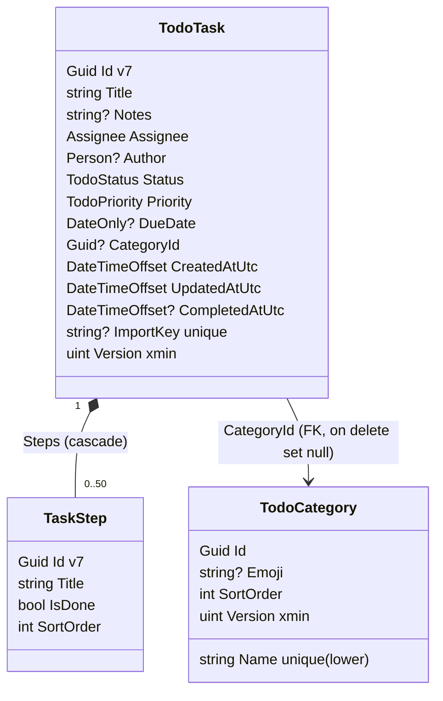

# Todos module

The family's to-do list: Masha and Vitaliy give tasks to themselves, to each other or to both, break them into steps,
change their status and priority, sort them by categories and find finished ones in an archive. It replaces the Google
Sheet «✅ Список дел» (sheet «Все дела») and its Telegram bot. The module was added in
[ADR 0030](../decisions/0030-todos-module-model.md) from the specification [specs/todos/001-todos-module](../specs/todos/001-todos-module/README.md).

Code: [`src/Modules/Todos`](../../src/Modules/Todos). Schema: `todos`.

## Model

- `TodoTask` is the aggregate root; its steps change only through `AddStep`, `UpdateStep` and `RemoveStep`. Every
  method sets `UpdatedAtUtc`, so the task row is written and its version changes.
- `TodoCategory` is its own aggregate. Deleting one leaves its tasks without a category (`ON DELETE SET NULL`).
- Enums, stored as text: `Assignee` `Vitaliy` · `Maria` · `Shared`; `Person` (the author) `Vitaliy` · `Maria`;
  `TodoStatus` `Todo` (Ждёт) · `InProgress` (В работе) · `Paused` (Отложено) · `Done` (Сделано) · `Cancelled`
  (Не актуально); `TodoPriority` `Urgent` (Срочно) · `High` (Важно) · `Normal` (Обычно) · `Low` (Когда-нибудь).

## Rules

| Rule | Error |
| --- | --- |
| A title (task or step) is trimmed, 1–200 characters. | `400` `todos.title_invalid` |
| Notes are trimmed, at most 4000 characters; empty notes are stored as `null`. | `400` `todos.notes_too_long` |
| A due date is optional, 2000-01-01 to 2100-12-31. | `400` `todos.due_date_out_of_range` |
| A category, when given, must exist. | `404` `todos.category_not_found` |
| A task has at most 50 steps; steps keep the order they were added in. | `400` `todos.too_many_steps` |
| `Todo`, `InProgress`, `Paused` are active; `Done`, `Cancelled` archived. Entering the archive sets `CompletedAtUtc`, leaving it clears it, moving between the two archived statuses keeps the first time. A new task is `Todo` unless the request says otherwise. | — |
| Task edits, status changes and deletes send the version in `If-Match`; a stale one answers `409`. Step changes need no version, but still move the task's version; when two land together the server reads the task again and reapplies the loser (`StepChanges`), so they do not conflict. | `409` `todos.changed_meanwhile` |
| A category name is trimmed, 1–50 characters, unique without regard to case; an optional emoji is at most 8 characters. A new category goes to the end (last `SortOrder` + 10). | `400` `todos.category_name_invalid`, `todos.category_emoji_too_long`; `409` `todos.category_name_taken` |
| A task create takes an `Idempotency-Key`: the same key and body return the first id, another body answers `409`. Category and step creates take none. | `409` `todos.idempotency_key_reused` |
| Unknown task or step. | `404` `todos.task_not_found`, `todos.step_not_found` |

Lists (R-012): active tasks by priority (Urgent first), then due date (earliest first, none last), then creation
(oldest first); the archive by completion time, newest first. Search splits the input into words; each word is an
escaped `LIKE` on `lower(title)`.

Summary (R-013): "today" is the date in `Europe/Kyiv`. Per assignee (always Maria, Vitaliy, Shared in that order):
active tasks, overdue (active with a due date before today) and due today. `doneLast7Days` counts tasks with status
`Done` completed in the last seven days. `focus` holds at most 8 active tasks: overdue by due date, then due today,
then the other `Urgent` ones, each group in list order (`SummaryFocus`, unit tested). The database applies the same
order and returns at most 8 rows, so a long overdue backlog is never loaded whole.

## Use cases

| Area | Commands | Queries |
| --- | --- | --- |
| `Features/Tasks` | `CreateTodoTask`, `UpdateTodoTask`, `ChangeTodoTaskStatus`, `DeleteTodoTask` | `ListTodoTasks`, `GetTodoTask` (shared projection and orders in `Tasks/Reading/`) |
| `Features/Steps` | `AddTodoTaskStep`, `UpdateTodoTaskStep`, `DeleteTodoTaskStep` | |
| `Features/Categories` | `CreateTodoCategory`, `UpdateTodoCategory`, `DeleteTodoCategory` | `ListTodoCategories` |
| `Features/Summary` | | `GetTodoSummary` |

## Layers

| Project | What is there |
| --- | --- |
| `Todos.Domain` | `Tasks/` (`TodoTask`, `TaskStep`, `TodoStatus`, `TodoPriority`, `TodoErrors`), `Categories/` (`TodoCategory`, `CategoryErrors`), `Parties/` (`Assignee`, `Person`). No EF Core, no ASP.NET Core. |
| `Todos.Application` | `ITodosDbContext` (the unit of work), `KyivCalendar` (today in Kyiv from `TimeProvider`), `Idempotency/` (`CreateRequest`, `TodoCreated`, the repeat rules), `Features/Steps/StepChanges` (the step write with its retry on a lost version race) and one folder per use case under `Features/`. |
| `Todos.Infrastructure` | `TodosDbContext` (schema `todos`); configurations in `Persistence/Tasks/` (tasks, steps, create requests) and `Persistence/Categories/` (categories, `CategorySeed`); migrations in `Persistence/Migrations/`; the development initializer. |
| `Todos.Api` | `TodosModule` (`AddTodosModule`, `MapTodosModule`), endpoints in `Endpoints/Tasks/Reading/` (list, get, summary), `Endpoints/Tasks/Editing/`, `Endpoints/Tasks/Status/`, `Endpoints/Steps/`, `Endpoints/Categories/`, and `TodoVersionHeader` (reads `If-Match`). |
| `Todos.Contracts` | Empty: no other module uses Todos yet. |

## Database

Schema `todos`, migration history in `todos.__ef_migrations_history`. Migration: `Initial`.

| Table | Columns | Indexes and keys |
| --- | --- | --- |
| `tasks` | `id uuid`, `title varchar(200)`, `notes varchar(4000) null`, `assignee varchar(16)`, `author varchar(16) null`, `status varchar(16)`, `priority varchar(16)`, `due_date date null`, `category_id uuid null`, `created_at_utc timestamptz`, `updated_at_utc timestamptz`, `completed_at_utc timestamptz null`, `import_key varchar(64) null`, `xmin` (version) | `PK_tasks`; `fk_tasks_categories` → `categories(id)` `ON DELETE SET NULL`; `ix_tasks_status_due_date`; `ix_tasks_completed_at_utc` (desc); `ix_tasks_category_id`; `ux_tasks_import_key` (unique, no filter); `ix_tasks_lower_title_trgm` (GIN `lower(title) gin_trgm_ops`, when `pg_trgm` is available) |
| `task_steps` | `id uuid`, `task_id uuid`, `title varchar(200)`, `is_done boolean`, `sort_order integer` | `PK_task_steps`; `fk_task_steps_tasks` → `tasks(id)` `ON DELETE CASCADE`; `ix_task_steps_task_id_sort_order` |
| `categories` | `id uuid`, `name varchar(50)`, `emoji varchar(8) null`, `sort_order integer`, `xmin` | `PK_categories`; `ux_categories_lower_name` (unique on `lower(name)`) |
| `create_requests` | `key varchar(100)`, `kind varchar(20)` (`task`), `fingerprint varchar(64)`, `entity_id uuid`, `created_at_utc timestamptz` | `PK_create_requests` on `key` |

Enum values are stored exactly as the C# names above (`Maria`, `InProgress`, `Urgent`, …).

The `Initial` migration creates `pg_trgm` (`CREATE EXTENSION IF NOT EXISTS`; it is a trusted extension, so the
database owner may create it). If the host refuses, the migration logs a notice and skips the trigram index; the
search still works, without the index.

Seeded categories (fixed ids, `CategorySeed`):

| Id | Emoji | Name | Sort |
| --- | --- | --- | --- |
| `0193b6a0-0000-7000-8000-000000000010` | 🏠 | Дом | 10 |
| `0193b6a0-0000-7000-8000-000000000020` | 🔨 | Ремонт | 20 |
| `0193b6a0-0000-7000-8000-000000000030` | 🩺 | Здоровье | 30 |
| `0193b6a0-0000-7000-8000-000000000040` | 💼 | Работа | 40 |
| `0193b6a0-0000-7000-8000-000000000050` | 💳 | Финансы | 50 |
| `0193b6a0-0000-7000-8000-000000000060` | 📄 | Документы | 60 |
| `0193b6a0-0000-7000-8000-000000000070` | 🛍️ | Покупки | 70 |
| `0193b6a0-0000-7000-8000-000000000080` | 🌴 | Отдых | 80 |

The deploy workflow builds a `todos` migrations bundle next to the Expenses one and runs both before the new
version starts ([ADR 0016](../decisions/0016-migrations-as-bundles-in-deploy.md)).

## HTTP API

Group `/api/todos`, tag `Todos`. Every write is anonymous, uses the `PublicWrite` rate limit and lists `429`.

| Operation | Method and path | Request | Response |
| --- | --- | --- | --- |
| `listTodoTasks` | `GET /tasks` | query `view` (`active` default, `archive`), `assignee` (repeatable), `categoryId`, `withoutCategory`, `search`, `page` (1), `pageSize` (50, at most 100) | `200 TodoTaskList`, `400` |
| `getTodoTask` | `GET /tasks/{id}` | | `200 TodoTaskItem`, `404` |
| `createTodoTask` | `POST /tasks` | `Idempotency-Key`; `TodoTaskRequest` (`title`, `notes?`, `assignee`, `author?`, `status?`, `priority`, `dueDate?`, `categoryId?`, `steps?`) | `201 TodoCreated`, `400`, `404`, `409` |
| `updateTodoTask` | `PUT /tasks/{id}` | `If-Match`; `TodoTaskUpdateRequest` (the same without `steps`, `status` required) | `204`, `400`, `404`, `409` |
| `changeTodoTaskStatus` | `PUT /tasks/{id}/status` | `If-Match`; `TodoTaskStatusRequest` (`status`) | `204`, `400`, `404`, `409` |
| `deleteTodoTask` | `DELETE /tasks/{id}` | `If-Match` | `204`, `404`, `409` |
| `addTodoTaskStep` | `POST /tasks/{id}/steps` | `TodoStepRequest` (`title`) | `201 TodoCreated`, `400`, `404` |
| `updateTodoTaskStep` | `PUT /tasks/{id}/steps/{stepId}` | `TodoStepUpdateRequest` (`title`, `isDone`) | `204`, `400`, `404` |
| `deleteTodoTaskStep` | `DELETE /tasks/{id}/steps/{stepId}` | | `204`, `404` |
| `listTodoCategories` | `GET /categories` | | `200 TodoCategoryItem[]` (with `version`, `activeCount`) |
| `createTodoCategory` | `POST /categories` | `TodoCategoryRequest` (`name`, `emoji?`) | `201 TodoCreated`, `400`, `409` |
| `updateTodoCategory` | `PUT /categories/{id}` | `If-Match`; `TodoCategoryRequest` | `204`, `400`, `404`, `409` |
| `deleteTodoCategory` | `DELETE /categories/{id}` | `If-Match` | `204`, `404`, `409` |
| `getTodoSummary` | `GET /summary` | | `200 TodoSummary` (`today`, `assignees`, `doneLast7Days`, `focus`) |

`TodoTaskItem` carries the notes, the category name and emoji, the steps in order, `stepsDone`, `stepsTotal` and
`version`, so the web opens a task without a second request. `If-Match` takes the `version` quoted or not; a missing
header is a `400`.

## Import from the sheet

There is no import endpoint ([ADR 0030](../decisions/0030-todos-module-model.md)). The 13 rows of «Все дела» go in
once through the SQL script `todos-import.sql`, kept with the other import scripts in the project files
(`home-app/import/`), which the owner runs in DBeaver against the database after the `Initial` migration:

1. Deploy (or migrate locally) so the `todos` schema and the seeded categories exist.
2. Open `todos-import.sql` in DBeaver on the `weretick` database and run it as a script. Every row is
   `INSERT … ON CONFLICT (import_key) DO NOTHING`, so running it again adds nothing twice.
3. Check: the active list shows the open rows, the archive the done ones.

Mapping: Чьё Маша / Виталий / Общее → `assignee` `Maria` / `Vitaliy` / `Shared`; Статус empty or Ждёт → `Todo`,
Сделано → `Done`, Не актуально → `Cancelled`; Приоритет «1 🔥…» → `Urgent`, «2 ⭐…» → `High`, «3 💭…» → `Low`, empty
→ `Normal`; Добавил(а) → `author`; Добавлено / Выполнено (Kyiv time) → `created_at_utc` (also `updated_at_utc`) /
`completed_at_utc`; ID → `import_key`; a «Виталию:» / «Маше:» prefix the old bot left in a title is dropped. The
script sets `id` itself (any unique uuid, for example `gen_random_uuid()`); `xmin` is managed by PostgreSQL.

## Tests

- Unit (`tests/UnitTests/Todos`): task rules, status transitions and completion time, steps, categories, validators,
  focus order and the Kyiv date.
- Integration (`tests/IntegrationTests/Api/Todos`): create, list, filters and search, archive and reopen, versions,
  idempotency, archive order, steps (including ticks sent together), categories (rename, delete keeps tasks, unique
  names), summary and its focus cap, the rate limit on every write,
  and the indexes the migration creates in SQL.
