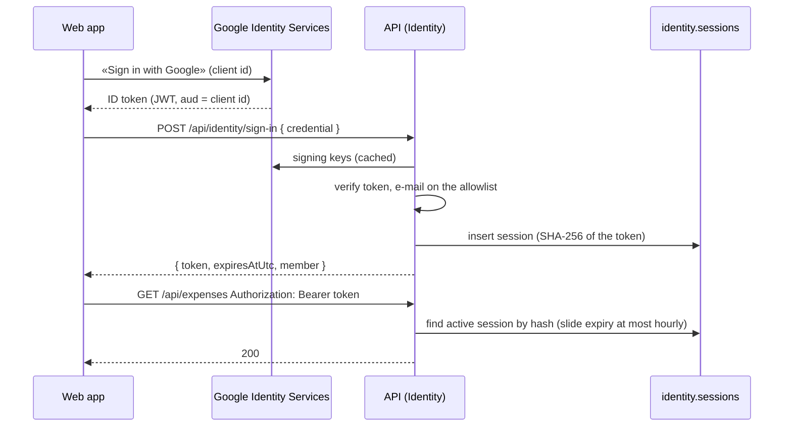
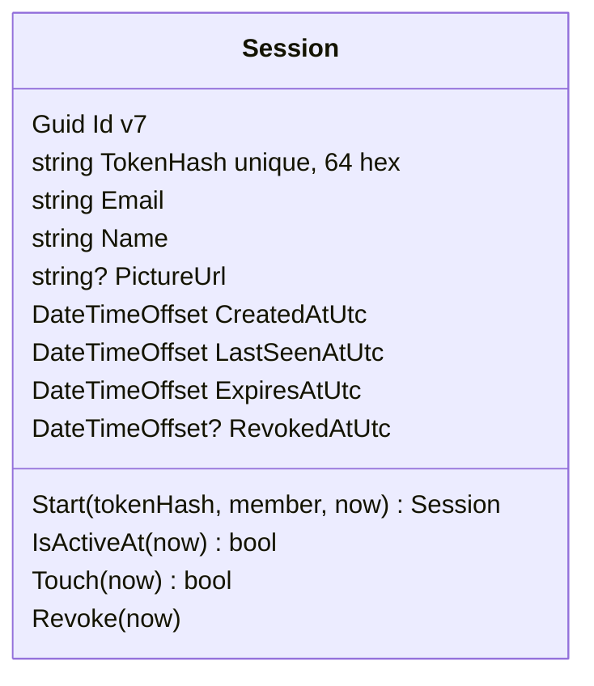

# Identity — design

Follows the module layout of [Notifications](../../../modules/notifications.md): five projects, an
`IdentityDbContext` with schema `identity`, use cases as `Commands/`, minimal API endpoints, `Result` errors.
Decision: [ADR 0037](../../../decisions/0037-google-sign-in-with-server-sessions.md).

## Flow

## Model

- `Session.Lifetime` = 30 days, `Session.TouchInterval` = 1 hour (R-005). `Touch` slides `ExpiresAtUtc` to
  `now + Lifetime` only when `LastSeenAtUtc` is older than the interval and returns whether it changed.
- `Revoke` is idempotent. `IsActiveAt(now)`: not revoked and `now < ExpiresAtUtc`.
- `IsStaleAt(now)` (R-012): revoked or expired more than 30 days before `now`.
- Errors (`IdentityErrors`): `identity.google_token_invalid` (401), `identity.not_a_member` (403),
  `identity.not_configured` (409).

## Schema `identity`

| Table | Columns | Indexes |
| --- | --- | --- |
| `sessions` | `id uuid pk`, `token_hash varchar(64)`, `email varchar(320)`, `name varchar(200)`, `picture_url varchar(2048) null`, `created_at_utc`, `last_seen_at_utc`, `expires_at_utc`, `revoked_at_utc null` (`timestamptz`) | unique `token_hash`; `email` |

Migration `Initial` only adds the schema and the table, so the previous release keeps working. The migrations bundle
for `identity` is added to `.github/workflows/api.yml`.

## Application

| Piece | Kind | Responsibility |
| --- | --- | --- |
| `Features/Sessions/Commands/SignIn` | command | verify the Google token (`IGoogleTokenVerifier`), check the allowlist (`FamilyAllowlist`), create the token (`SessionTokens`), store the session, delete the member's stale sessions; returns `IdentitySession` |
| `Features/Sessions/Commands/SignOut` | command | revoke the session with the token's hash; `204` also when it is already gone (sign-out never fails) |
| `Authentication/SessionAuthenticator` | service | for a bearer token: hash, find the session, check `IsActiveAt` and the allowlist, `Touch` and save when it changed; returns `FamilyMember?`. Used by the authentication handler, not a use case: it runs on every request before any endpoint. |
| `Authentication/SessionTokens` | pure | `New()` = 32 random bytes base64url; `Hash(token)` = lower-case hex SHA-256 |
| `Members/FamilyAllowlist` | pure | the configured e-mails, normalised; `Contains(email)` |
| `IGoogleTokenVerifier` | port | `VerifyAsync(credential)` → `GoogleIdentity?` (e-mail, verified flag, name, picture); `IsConfigured` |
| `IdentitySettings` | options | `Identity:Google:ClientId`, `Identity:AllowedEmails` |

## Infrastructure

- `IdentityDbContext` (`ModuleDbContext`, schema `identity`), `SessionConfiguration`, `IdentityDatabaseInitializer`.
- `Google/GoogleTokenVerifier`: `GoogleJsonWebSignature.ValidateAsync` from `Google.Apis.Auth` with the audience =
  the client id and a 5-minute clock tolerance; Google's keys are cached by the library. Any `InvalidJwtException`
  means `null` (R-001).

## Api

| Piece | Responsibility |
| --- | --- |
| `IdentityModule.AddIdentityModule` | the module, the authentication schemes (`Session` default, `SchedulerKey`) and the authorization fallback policy: an authenticated user of either scheme |
| `Authentication/SessionAuthenticationHandler` | `Authorization: Bearer` → `SessionAuthenticator`; claims `email`, `name`, `picture`; no header → no result, a bad token → fail |
| `Authentication/SchedulerKeyAuthenticationHandler` | `GET`/`HEAD` with the right `X-Scheduler-Key` → the principal `scheduler` (R-010); compares in constant time through `SchedulerKey` |
| `Endpoints/SignInEndpoint` | `POST /api/identity/sign-in`, anonymous, `SignIn` rate limit |
| `Endpoints/SignOutEndpoint` | `POST /api/identity/sign-out`, `PublicWrite` rate limit |
| `Endpoints/GetCurrentMemberEndpoint` | `GET /api/identity/me` from the session's claims |

The handler for the scheduler key lives in the Identity module because the module decides who may call the API; the
key itself stays in `BuildingBlocks.Api.Scheduling`.

## Contract

All under `/api/identity`, tag `Identity`.

| Operation | Name | Request | Responses |
| --- | --- | --- | --- |
| `POST /sign-in` | `signIn` | `SignInRequest { credential }` | `200 IdentitySession { token, expiresAtUtc, member }`, `400`, `401`, `403`, `409`, `429` |
| `POST /sign-out` | `signOut` | — | `204`, `401`, `429` |
| `GET /me` | `getCurrentMember` | — | `200 FamilyMember { email, name, pictureUrl }`, `401` |

- `signIn` takes no `Idempotency-Key`: a second sign-in only stores a second session, which harms nothing; the
  exception is named in the OpenAPI test with this SDD.
- Every other operation of every module now also answers `401` (problem body from the status code pages); it is not
  listed per operation in the document, because the fallback policy adds it to all of them (ADR 0037).

## Anonymous endpoints (R-009)

| Endpoint | Why |
| --- | --- |
| `GET /health`, `GET /api/system/status` | deploy and uptime checks; no family data |
| `POST /api/identity/sign-in` | the way in |
| `POST /internal/outbox/tick`, `POST /internal/notifications/tick` | scheduler key header (ADR 0006, 0034) |
| `POST /telegram/webhook/…` | Telegram secret header (ADR 0033) |

Each is marked `.AllowAnonymous()` in its file; `AuthorizationRulesTests` fails on any other file that does so, and
`IdentityProtectionApiTests` calls every `GET` of the OpenAPI document without a token and expects `401`.

## Configuration

| Setting | Production (App Service) | Tests |
| --- | --- | --- |
| `Identity:Google:ClientId` | `Identity__Google__ClientId` | `integration-client-id`, with a fake verifier |
| `Identity:AllowedEmails` | `Identity__AllowedEmails__0`, `__1` | two test e-mails |

Neither is a secret, but they are not committed either: the allowlist holds personal addresses.
