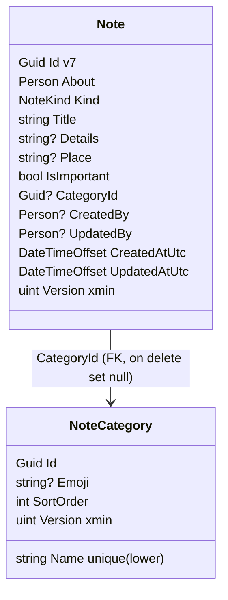

# Notes — design

Follows the module layout of [Todos](../../../modules/todos.md): five projects, a `NotesDbContext` with schema
`notes`, use cases as `Commands/` and `Queries/` folders, minimal API endpoints, `Result` errors, row versions from
`xmin` ([ADR 0017](../../../decisions/0017-row-version-via-xmin-for-edits.md)), `Idempotency-Key` on creates
([ADR 0007](../../../decisions/0007-idempotency-key-for-creates.md)). Decisions:
[ADR 0039](../../../decisions/0039-notes-module-model.md), [ADR 0040](../../../decisions/0040-current-member-through-identity-contracts.md).

## Model

- `Note` and `NoteCategory` are separate aggregates. `Note.Create(...)` and `Note.Update(...)` check R-001…R-005 and
  R-007 and return `Result`; `Update` sets `UpdatedBy` and `UpdatedAtUtc`.
- `Person` (`Vitaliy`, `Maria`) and `NoteKind` (`Likes`, `Dislikes`, `Fact`) are domain enums stored as text. The kind
  gets a rank only in queries (Likes 0, Dislikes 1, Fact 2).
- Domain errors (`NoteErrors`, `CategoryErrors`): `notes.title_invalid`, `notes.details_too_long`,
  `notes.place_too_long`, `notes.note_not_found` (404), `notes.category_not_found` (404),
  `notes.category_name_invalid`, `notes.category_emoji_too_long`, `notes.category_name_taken` (409),
  `notes.changed_meanwhile` (409). Messages in Ukrainian ([ADR 0037](../../../decisions/0037-ukrainian-user-facing-texts.md)).

## Who is signed in (ADR 0040)

`Identity.Contracts` gets `ICurrentMember` with `SignedInMember? Get()` and the record
`SignedInMember(string Email, string Name, HouseholdPerson? Person)`, `HouseholdPerson` = `Vitaliy`, `Maria`.
`Identity.Api` implements it over `IHttpContextAccessor` and the session claims (scoped); the person comes from the
allowlist order (`Identity:AllowedEmails:0` is Vitaliy, `:1` is Maria, the identity work's ADR 0038). `null` outside a
member's request (the scheduler key). `Notes.Application` references `Identity.Contracts` only and maps
`HouseholdPerson` to its own `Person`; no module reads claims itself.

## Schema `notes`

| Table | Columns |
| --- | --- |
| `notes` | `id uuid pk`, `about varchar(16)`, `kind varchar(16)`, `title varchar(200)`, `details varchar(2000) null`, `place varchar(200) null`, `is_important bool`, `category_id uuid null fk → categories(id) on delete set null`, `created_by varchar(16) null`, `updated_by varchar(16) null`, `created_at_utc timestamptz`, `updated_at_utc timestamptz`, `xmin` as version. Indexes: `(about, kind)`, `category_id`. |
| `categories` | `id uuid pk`, `name varchar(50)`, `emoji varchar(8) null`, `sort_order int`, `xmin`. Unique index on `lower(name)`. |
| `create_requests` | idempotency keys, same shape as `todos.create_requests`. |

Seeded categories (fixed ids in `CategorySeed`, sort 10, 20, …): 🍲 Їжа, 🥤 Напої, 💐 Квіти, 💻 Техніка, 👕 Одяг,
🎬 Дозвілля, ✈️ Подорожі, 🩺 Здоров'я, 🏠 Дім, 📝 Інше. Migration `Initial` creates the schema, the tables and the seed;
no extension (the hosting forbids `pg_trgm`, and hundreds of rows need no index for the search). The deploy workflow
gets a `Notes` migrations bundle ([ADR 0016](../../../decisions/0016-migrations-as-bundles-in-deploy.md)) and the
smoke step reads `GET /api/notes/items` and `GET /api/notes/categories` with the scheduler key (root ADR 0005).

## Contract (`/api/notes`, tag `Notes`)

All writes: `RequireRateLimiting(PublicWrite)`, `429` listed, `401` listed. Edits and deletes send `If-Match: <version>`.

| Name | Method and path | Request | Response |
| --- | --- | --- | --- |
| `listNotes` | `GET /items` | query: `about` (`Vitaliy`/`Maria`), `kind` (repeatable), `categoryId`, `withoutCategory` (bool), `search` | `200 NoteItem[]`, `400` |
| `createNote` | `POST /items` | `Idempotency-Key`; `NoteRequest { about, kind, title, details?, place?, categoryId?, isImportant }` | `201 { id }`, `400`, `404` category, `409` key reuse |
| `updateNote` | `PUT /items/{id}` | `If-Match`; `NoteRequest` | `204`, `400`, `404`, `409` |
| `deleteNote` | `DELETE /items/{id}` | `If-Match` | `204`, `404`, `409` |
| `listNoteCategories` | `GET /categories` | | `200 NoteCategoryItem[] { id, name, emoji, sortOrder, version, noteCount }` |
| `createNoteCategory` | `POST /categories` | `{ name, emoji? }` | `201 { id }`, `400`, `409` name taken |
| `updateNoteCategory` | `PUT /categories/{id}` | `If-Match`; `{ name, emoji? }` | `204`, `400`, `404`, `409` |
| `deleteNoteCategory` | `DELETE /categories/{id}` | `If-Match` | `204`, `404`, `409` |

`NoteItem`: `id, about, kind, title, details, place, isImportant, categoryId, categoryName, categoryEmoji, createdBy,
updatedBy, createdAtUtc, updatedAtUtc, version`.

Category creation takes no `Idempotency-Key`, as in Todos: a repeat hits the unique name and answers `409`.

## Application

- `INotesDbContext` port with `Notes`, `Categories`, `CreateRequests`, `SaveChangesAsync`.
- `TimeProvider` for the times; `ICurrentMember` for `CreatedBy` / `UpdatedBy`.
- The list: projection to `NoteItem`, `AsNoTracking`, filters in SQL, search by words as escaped `ILIKE` on
  `lower(title)`, `lower(details)` and `lower(place)` (BuildingBlocks `SearchPattern`), order of R-012 in SQL,
  `Take(1000)`.
- Every command saves once; a unique index violation on the category name becomes `409`.
