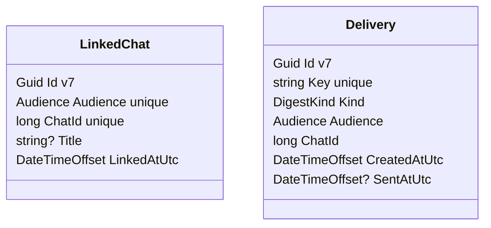

# Notifications — design

Follows the module layout of [Todos](../../../modules/todos.md): five projects, a `NotificationsDbContext` with schema
`notifications`, use cases as `Commands/` and `Queries/`, minimal API endpoints, `Result` errors. Decisions:
[ADR 0033](../../../decisions/0033-notifications-module-and-telegram-webhook.md) (module, webhook, linking),
[ADR 0034](../../../decisions/0034-scheduler-github-actions-cron.md) (scheduler),
[ADR 0035](../../../decisions/0035-integration-events-through-the-outbox.md) (outbox between modules).

## Model

- `Audience`: `Vitaliy`, `Maria`, `Family`. `DigestKind`: `TodosMorning`, `TodosCommon`, `GiftReminder`,
  `ShoppingEvening`, `ExpensesWeek`, `ExpensesMonth`. Stored as text.
- `DigestSchedule` (Domain, pure): for a Kyiv local time it returns the due slots `(kind, period)`; the windows are
  the single source of the schedule (table below) and are also shown on the site.
- Errors: `notifications.chat_not_linked` (404), `notifications.not_configured` (409),
  `notifications.telegram_failed` (409), `notifications.audience_invalid` (400).

## Schedule (Europe/Kyiv)

| Kind | Days | Window | Period key |
| --- | --- | --- | --- |
| `TodosMorning` | every day | 08:00–11:59 | the date |
| `TodosCommon` | every day | 08:00–11:59 | the date |
| `GiftReminder` | every day | 08:00–11:59 | `<giftId>:<buyBy>` |
| `ShoppingEvening` | every day | 18:00–21:59 | the date |
| `ExpensesWeek` | Sunday | 20:00–23:59 | the Monday of the week |
| `ExpensesMonth` | last day of the month 20:00–23:59; the 1st 00:00–11:59 (previous month) | | `yyyy-MM` |

## Schema `notifications`

| Table | Columns |
| --- | --- |
| `linked_chats` | `id uuid pk`, `audience varchar(16)` unique, `chat_id bigint` unique, `title varchar(200) null`, `linked_at_utc timestamptz` |
| `deliveries` | `id uuid pk`, `key varchar(200)` unique, `kind varchar(32)`, `audience varchar(16)`, `chat_id bigint`, `created_at_utc timestamptz`, `sent_at_utc timestamptz null`; index `created_at_utc desc` |
| `outbox_messages` | the shared outbox table ([ADR 0006](../../../decisions/0006-outbox-with-scheduled-tick.md)) |

Migration `Initial` only adds the schema and tables. The deploy workflow gets a `Notifications` migrations bundle.

## Reading other modules (Contracts, implemented by the owners)

| Interface | Owner | Gives |
| --- | --- | --- |
| `Todos.Contracts.ITodosDigest` | Todos | active tasks: id, title, assignee, due date, priority |
| `Todos.Contracts.ITodoCompletion` | Todos | `CompleteAsync(taskId)` → `Completed`, `AlreadyClosed`, `NotFound` |
| `Gifts.Contracts.IGiftsDigest` | Gifts | wanted gifts with giver and buy-by in a range, with the site link |
| `Shopping.Contracts.IShoppingDigest` | Shopping | needed items with department name and order |
| `Expenses.Contracts.IExpensesDigest` | Expenses | a period (week) report and a month report built from the existing month summary |

## Telegram

- Port `ITelegramBot` (Application), adapter `TelegramBotClient` (Infrastructure, typed `HttpClient` to
  `https://api.telegram.org/bot<token>/`): `SendAsync` (throws on failure, used by the outbox handler), `TryReplyAsync`
  and `TryAnswerCallbackAsync` (best effort, for interactive answers), `GetUsernameAsync` (cached for an hour),
  `EnsureWebhookAsync(url)`.
- Webhook url: `Notifications:ApiUrl`, else `https://{WEBSITE_HOSTNAME}` (set by App Service); path
  `/api/notifications/telegram/webhook`; `secret_token` = first 32 hex characters of SHA-256 of `webhook:<token>`;
  `allowed_updates` = `message`, `callback_query`, `my_chat_member`.
- Texts use HTML parse mode; titles are HTML-escaped. Callback data: `me:Vitaliy`, `me:Maria`, `done:<task id N>`.

## Contract

Site operations (`/api/notifications`, tag `Notifications`, in OpenAPI):

| Name | Method and path | Request | Response |
| --- | --- | --- | --- |
| `getNotificationsStatus` | `GET /status` | | `200 NotificationsStatus { configured, botUsername?, botLink?, chats: NotificationChatItem[] { audience, linked, title?, linkedAtUtc? }, schedule: NotificationScheduleItem[] { kind, title, when }, deliveries: NotificationDeliveryItem[] { kind, audience, key, createdAtUtc, sentAtUtc? } (last 10) }` |
| `unlinkNotificationsChat` | `DELETE /chats/{audience}` | | `204`, `400`, `404`, `429` |
| `sendNotificationsTest` | `POST /test` | `NotificationsTestRequest { audience }` | `204`, `400`, `404`, `409`, `429` |

Machine operations (hidden from OpenAPI, no rate limit, secret header):

| Path | Caller | Header |
| --- | --- | --- |
| `POST /api/notifications/telegram/webhook` | Telegram | `X-Telegram-Bot-Api-Secret-Token` |
| `POST /internal/notifications/tick` | scheduler | `X-Scheduler-Key` → `200 { configured, webhook, planned }` |

The test send is not a create (`204`, nothing stored), so it takes no `Idempotency-Key`: a repeat only sends one more
test message.

## Application

- `INotificationsDbContext`: `Chats`, `Deliveries`, `Publish(message)`, `SaveChangesAsync`.
- `RunTick` (command, no input): reads the linked chats and the already planned keys of the last two days, asks
  `DigestSchedule` for the due slots, reads only the sources those slots need, renders each message with a pure
  text type (`Texts/…`), adds deliveries and outbox messages, saves once; a unique-key race with a parallel tick
  answers "nothing planned" for that tick.
- `HandleTelegramUpdate` (command): linking (R-002, R-003), `/today`, `/help`, `done:` callbacks. Saves at most once.
- `UnlinkChat`, `SendTestMessage` (commands), `GetNotificationsStatus` (query).
- Outbox message `TelegramMessage { deliveryId, chatId, text, buttons }` → `TelegramMessageHandler`: send, then set
  `sent_at_utc` (safe to repeat; a repeat after a lost save sends a duplicate, accepted).
