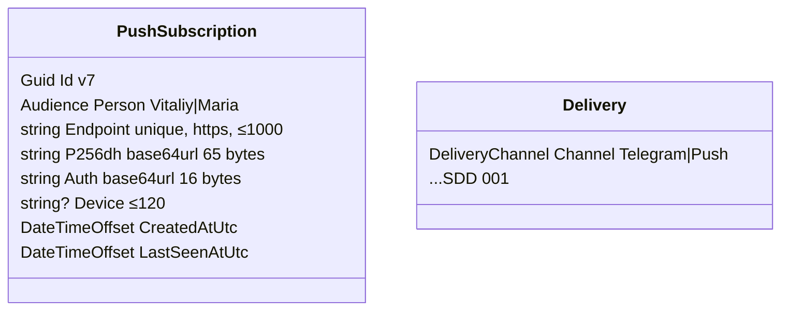

# Web Push — design

Extends the Notifications module of [SDD 001](../001-telegram-bot/design.md); same layers and conventions. Decision:
[ADR 0042](../../../decisions/0042-web-push-next-to-telegram.md).

## Model

- `PushSubscription` (aggregate, `Domain/Push`): `Save(person, endpoint, keys, device, now)` creates one; `Refresh(...)`
  updates keys, owner, label and `LastSeenAtUtc` when the same endpoint is saved again (R-102). Validation of the
  endpoint and keys lives in the command validator; the entity trims and cuts the label.
- `Delivery` gets `Channel` (`DeliveryChannel`: `Telegram`, `Push`). `Delivery.KeyOf(channel, …)` keeps the Telegram key
  `<kind>:<period>:<audience>` and gives push `push:<kind>:<period>:<audience>` (R-106). `ChatId` is `0` for push.
- Errors (`PushErrors`): `notifications.push_not_configured` (409), `notifications.push_no_person` (409),
  `notifications.push_device_not_found` (404), `notifications.push_no_devices` (404), `notifications.push_failed` (409).

## Schema `notifications` (migration `WebPush`, additive)

| Table | Change |
| --- | --- |
| `push_subscriptions` | new: `id uuid pk`, `person varchar(16)`, `endpoint varchar(1000)` unique, `p256dh varchar(200)`, `auth varchar(100)`, `device varchar(120) null`, `created_at_utc timestamptz`, `last_seen_at_utc timestamptz`; index `person` |
| `deliveries` | new column `channel varchar(16) not null default 'Telegram'` (existing rows are Telegram) |

Additive only: the previous release keeps working while the migration runs before the new code.

## Planning (tick)

`RunTickHandler` builds two target maps: the linked Telegram chats (when the bot is configured) and the people with
at least one push device (when push is configured, `{person → 0}`, never `Family`). `DigestPlanner.Plan` runs once per
map; its routing already gives the push rules of R-105, because the push map has no `Family` entry (common →
every person in the map; a giver without an entry is dropped). `PushTexts` turns a planned message into a
`PushMessage` (title, plain text, page, tag; R-107). The "skip slots already planned" step collects the keys of both
channels. Each new message is a `Delivery` plus its outbox message (`TelegramMessage` or `PushMessage`) in one save;
a unique-key clash means a parallel tick won and nothing is planned (R-106).

The planner now also gives each `PlannedMessage` its site page (`Page`, a path) so the push knows where a tap leads;
the gift reminder's page is `/gifts?gift=<id>`.

## Sending

- Port `IWebPush` (Application): `IsConfigured`, `PublicKey`, `SendAsync(target, payload)` → `PushOutcome`
  (`Delivered`, `Gone`, `Failed`).
- `PushMessageHandler` (outbox): sends to every device of the person; deletes `Gone` devices; sets `sent_at_utc` when
  any device accepted or none is left; throws when every device `Failed`, so the outbox retries (R-108).
- Infrastructure `Push/`:
  - `WebPushOptions` (`WebPush:PublicKey`, `WebPush:PrivateKey`, `WebPush:Subject`, default subject = the site URL).
  - `PushEncryption` — RFC 8291 `aes128gcm`: a fresh P-256 key pair and 16-byte salt per message; ECDH with the
    browser key; HKDF-SHA256 (`WebPush: info`, `Content-Encoding: aes128gcm`, `Content-Encoding: nonce`); one record
    (`rs` 4096) with the `0x02` delimiter; AES-128-GCM. Only `System.Security.Cryptography`, no package.
  - `VapidToken` — ES256 JWT (`aud` = the endpoint's origin, `exp` = now + 12 h, `sub` = subject), header
    `Authorization: vapid t=<jwt>, k=<public key>`.
  - `WebPushClient` — `POST` to the endpoint with `TTL: 43200`, `Urgency: normal`, `Content-Encoding: aes128gcm`;
    `201/200/202` → `Delivered`; `404/410` → `Gone`; anything else or a network error → `Failed` (logged without the
    endpoint's secret path).
- Payload JSON (read by the service worker, web platform/002): `{ "title", "body", "url", "tag" }`.

## Contract (`/api/notifications/push`, tag Notifications)

| Operation | Name | Request | Responses |
| --- | --- | --- | --- |
| `GET /api/notifications/push` | `getPushStatus` | — | `200 PushStatus { configured, publicKey?, canSubscribe, devices: PushDevice[] }` |
| `PUT /api/notifications/push/subscriptions` | `savePushSubscription` | `SavePushSubscriptionRequest { endpoint, p256dh, auth, device? }` | `200 PushDevice`, `400`, `409` |
| `DELETE /api/notifications/push/subscriptions/{id}` | `deletePushSubscription` | — | `204`, `404` |
| `POST /api/notifications/push/test` | `sendPushTest` | — | `200 PushTestResult { delivered }`, `404`, `409` |

`PushDevice { id, device?, endpoint, createdAtUtc, lastSeenAtUtc }` — the endpoint lets the page mark «цей пристрій».
`NotificationDeliveryItem` (status) gets `channel`. No `Idempotency-Key`: the save is an upsert (R-102), the test
stores nothing.

## Use cases

| Use case | Folder |
| --- | --- |
| `GetPushStatusQuery` | `Features/Push/Queries/GetPushStatus` |
| `SavePushSubscriptionCommand` (+ validator) | `Features/Push/Commands/SavePushSubscription` |
| `DeletePushSubscriptionCommand` | `Features/Push/Commands/DeletePushSubscription` |
| `SendPushTestCommand` | `Features/Push/Commands/SendPushTest` |

## Configuration

`WebPush__PublicKey`, `WebPush__PrivateKey` (App Service settings; generated once, see `docs/deploy.md`),
optional `WebPush__Subject`. Integration tests run without keys (push not configured) plus a fake `IWebPush`.
