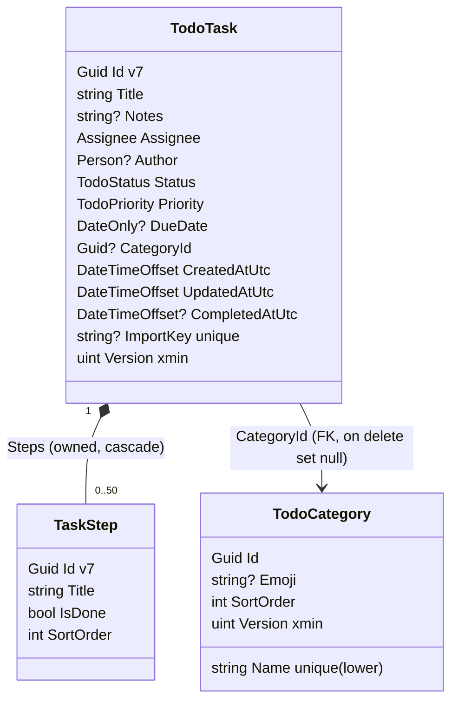

# Todos — design

Follows the module layout of [Expenses](../../../modules/expenses.md): five projects, a `TodosDbContext` with schema
`todos`, use cases as `Commands/` and `Queries/` folders, minimal API endpoints, `Result` errors, row versions from
`xmin` ([ADR 0017](../../../decisions/0017-row-version-via-xmin-for-edits.md)), `Idempotency-Key` on creates
([ADR 0007](../../../decisions/0007-idempotency-key-for-creates.md)).

## Model

- `TodoTask` is the aggregate root; `TaskStep` is an entity inside it, changed only through the task's methods
  (`AddStep`, `UpdateStep`, `RemoveStep`). Every method sets `UpdatedAtUtc`, so the task row is written and its
  `xmin` changes (R-010).
- `TodoCategory` is its own aggregate. A foreign key from `tasks.category_id` to `categories.id` is allowed: both are
  in the same schema. `ON DELETE SET NULL` keeps tasks of a deleted category (R-008).
- Enums are stored as text (`HasConversion<string>()`), as in Expenses. `Assignee`: `Vitaliy`, `Maria`, `Shared`.
  `Person`: `Vitaliy`, `Maria`. `TodoStatus`, `TodoPriority` as in the requirements. `TodoPriority` gets a numeric
  rank only in queries (Urgent 0 … Low 3), never stored.
- Domain errors (`TodoErrors`, `CategoryErrors`): `todos.title_invalid`, `todos.notes_too_long`,
  `todos.due_date_out_of_range`, `todos.too_many_steps`, `todos.step_not_found` (404), `todos.task_not_found` (404),
  `todos.category_not_found` (404), `todos.category_name_invalid`, `todos.category_name_taken` (409),
  `todos.changed_meanwhile` (409).

## Schema `todos`

| Table | Columns |
| --- | --- |
| `tasks` | `id uuid pk`, `title varchar(200)`, `notes varchar(4000) null`, `assignee varchar(16)`, `author varchar(16) null`, `status varchar(16)`, `priority varchar(16)`, `due_date date null`, `category_id uuid null fk → categories(id) on delete set null`, `created_at_utc timestamptz`, `updated_at_utc timestamptz`, `completed_at_utc timestamptz null`, `import_key varchar(64) null unique`, `xmin` as version. Indexes: `(status, due_date)`, `(completed_at_utc desc)`, `category_id`, trigram GIN on `lower(title)`. |
| `task_steps` | `id uuid pk`, `task_id uuid fk → tasks(id) on delete cascade`, `title varchar(200)`, `is_done bool`, `sort_order int`. Index `(task_id, sort_order)`. |
| `categories` | `id uuid pk`, `name varchar(50)`, `emoji varchar(8) null`, `sort_order int`, `xmin`. Unique index on `lower(name)`. |
| `create_requests` | idempotency keys, same shape as `expenses.create_requests`. |

Seeded categories (fixed ids in `CategorySeed`, sort 10, 20, …): 🏠 Дом, 🔨 Ремонт, 🩺 Здоровье, 💼 Работа,
💳 Финансы, 📄 Документы, 🛍️ Покупки, 🌴 Отдых. Migration `Initial` creates the schema, the tables, the
`pg_trgm` extension if missing, and the seed. The deploy workflow gets a `Todos` migrations bundle
([ADR 0016](../../../decisions/0016-migrations-as-bundles-in-deploy.md)).

## Contract (`/api/todos`, tag `Todos`)

All writes: `RequireRateLimiting(PublicWrite)`, `429` listed. Edits send `If-Match: <version>`.

| Name | Method and path | Request | Response |
| --- | --- | --- | --- |
| `listTodoTasks` | `GET /tasks` | query: `view` (`active` default / `archive`), `assignee` (repeatable), `categoryId`, `withoutCategory` (bool), `search`, `page` (1), `pageSize` (50, ≤100) | `200 TodoTaskList { items: TodoTaskItem[], page, pageSize, totalCount }` |
| `getTodoTask` | `GET /tasks/{id}` | | `200 TodoTaskItem`, `404` |
| `createTodoTask` | `POST /tasks` | `Idempotency-Key`; `TodoTaskRequest { title, notes?, assignee, author?, status?, priority, dueDate?, categoryId?, steps?: string[] }` | `201 { id }`, `400`, `404` category, `409` key reuse |
| `updateTodoTask` | `PUT /tasks/{id}` | `If-Match`; `TodoTaskRequest` without `steps` (status included) | `204`, `400`, `404`, `409` |
| `changeTodoTaskStatus` | `PUT /tasks/{id}/status` | `If-Match`; `{ status }` | `204`, `400`, `404`, `409` |
| `deleteTodoTask` | `DELETE /tasks/{id}` | `If-Match` | `204`, `404`, `409` |
| `addTodoTaskStep` | `POST /tasks/{id}/steps` | `{ title }` | `201 { id }`, `400`, `404` |
| `updateTodoTaskStep` | `PUT /tasks/{id}/steps/{stepId}` | `{ title, isDone }` | `204`, `400`, `404` |
| `deleteTodoTaskStep` | `DELETE /tasks/{id}/steps/{stepId}` | | `204`, `404` |
| `listTodoCategories` | `GET /categories` | | `200 TodoCategoryItem[] { id, name, emoji, sortOrder, version, activeCount }` |
| `createTodoCategory` | `POST /categories` | `{ name, emoji? }` | `201 { id }`, `400`, `409` name taken |
| `updateTodoCategory` | `PUT /categories/{id}` | `If-Match`; `{ name, emoji? }` | `204`, `400`, `404`, `409` |
| `deleteTodoCategory` | `DELETE /categories/{id}` | `If-Match` | `204`, `404`, `409` |
| `getTodoSummary` | `GET /summary` | | `200 TodoSummary` |

`TodoTaskItem`: `id, title, notes, assignee, author, status, priority, dueDate, categoryId, categoryName,
categoryEmoji, createdAtUtc, updatedAtUtc, completedAtUtc, steps: TaskStepItem[] { id, title, isDone },
stepsDone, stepsTotal, version`. Steps come in their order. A list is small enough to carry steps and notes, so the
web needs no second request to open a task.

`TodoSummary`: `today` (Kyiv date), `assignees: AssigneeCounts[] { assignee, active, overdue, dueToday }` (always the
three, in the order Maria, Vitaliy, Shared), `doneLast7Days`, `focus: TodoTaskItem[]` (at most 8: overdue by due
date, then due today, then active `Urgent` without a date or later, by R-012).

Category creation takes no `Idempotency-Key`: a repeat hits the unique name and answers `409`, which the web treats
as done after a retry. Recorded in the module ADR.

## Application

- `ITodosDbContext` port with `Tasks`, `Categories`, `CreateRequests`, `SaveChangesAsync`.
- `TimeProvider` for now and for the Kyiv "today" (`TodayInKyiv` helper in Application, time zone
  `Europe/Kyiv`).
- Lists: projection to `TodoTaskItem`, `AsNoTracking`, paging in SQL, search by words as escaped `ILIKE` on
  `lower(title)` (BuildingBlocks `SearchPattern`).
- Every command saves once; a unique index violation on the category name becomes `409`. Step commands that lose
  the race on the task's `xmin` to another write read the task again and reapply (one commit in the end, see
  [ADR 0030](../../../decisions/0030-todos-module-model.md)).
- The summary focus is ordered and capped at 8 rows in SQL.

## Import (SQL, not an endpoint)

Unlike Expenses ([ADR 0014](../../../decisions/0014-one-time-sheet-import.md)) there is no import endpoint: the sheet is
13 rows, so the import is a plain idempotent SQL script `todos-import.sql` the owner runs in DBeaver
(`INSERT … ON CONFLICT (import_key) DO NOTHING`), kept with the other import scripts in the project files and
described on the module page. Mapping: Чьё Маша/Виталий/Общее → `Maria`/`Vitaliy`/`Shared`; Статус empty or Ждёт →
`Todo`, Сделано → `Done`, Не актуально → `Cancelled`; Приоритет «1 🔥…» → `Urgent`, «2 ⭐…» → `High`,
«3 💭…» → `Low`, empty → `Normal`; Добавил(а) → `author`; Добавлено / Выполнено (Kyiv time) → `created_at_utc` /
`completed_at_utc`; ID → `import_key`; a «Виталию:» / «Маше:» prefix left in a title by the old bot is dropped.
