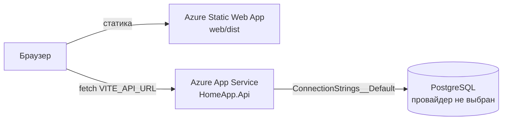

# Архитектура



Фронт и API живут на разных адресах. Фронт собирается в статику и вызывает API по полному адресу из `VITE_API_URL`
(подставляется при сборке). API разрешает этот origin через CORS (`Cors:Origins`). Бесплатный Static Web App не умеет
проксировать запросы в отдельный App Service, поэтому так.

## API (`api/`)

```
api/
  HomeApp.slnx, global.json, Directory.*.props   один SDK и версии пакетов на всё решение
  compose.yaml                                     локальный PostgreSQL
  src/HomeApp.Api/
    Program.cs                                     сборка приложения
    Platform/                                      CORS, health, проверка базы
    Features/<Область>/                            появится с первой фичей
  tests/HomeApp.Api.Tests/                         тесты через WebApplicationFactory
```

`GET /health` отдаёт JSON: `status`, `version` (версия сборки с коммитом), `environment` и `checks`. Проверка базы
включается, только если задан `ConnectionStrings:Default`; без строки подключения API работает и считается здоровым.
OpenAPI-документ доступен на `/openapi/v1.json` только в Development.

## Web (`web/`)

```
web/
  src/main.tsx                 точка входа
  src/app/                     App, глобальные стили
  src/platform/api-client.ts   единственное место, где фронт делает fetch к API
  src/features/health/         проверка связи с API
  public/staticwebapp.config.json   fallback на index.html для SPA (на другом хостинге просто игнорируется)
```

## Конфигурация

| Настройка | Где задаётся | Пример |
| --- | --- | --- |
| `Cors:Origins` | `appsettings.Development.json`, в Azure `Cors__Origins__0` | `https://ambitious-beach-0b1d13b10.6.azurestaticapps.net` |
| `ConnectionStrings:Default` | локально `appsettings.Development.json` или user-secrets, в Azure переменная App Service | `Host=...;Database=home;Username=...;Password=...` |
| `VITE_API_URL` | `web/.env.local`, в CI переменная репозитория (по умолчанию адрес API) | `http://localhost:5000` |
