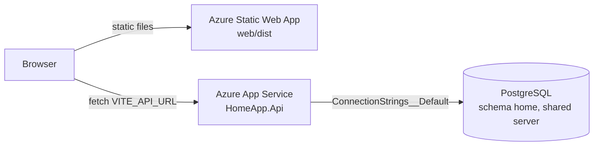

# Architecture



The front and the API live on different hosts. The front is built into static files and calls the API by the full
address from `VITE_API_URL` (substituted at build time). The API allows that origin through CORS (`Cors:Origins`). A
free Static Web App cannot proxy requests to a separate App Service, which is why it works this way.

## API (`api/`)

```
api/
  HomeApp.slnx, global.json, Directory.*.props   one SDK and package versions for the whole solution
  compose.yaml                                     local PostgreSQL
  src/HomeApp.Api/
    Program.cs                                     application setup
    Platform/                                      CORS, health, HomeDbContext, database check
    Features/<Area>/                               appears with the first feature
  tests/HomeApp.Api.Tests/                         tests through WebApplicationFactory
```

`GET /health` returns JSON: `status`, `version` (build version with the commit), `environment` and `checks`. The
database check is on only when `ConnectionStrings:Default` is set; without a connection string the API works and
reports healthy.

Data access goes through one EF Core context, `HomeDbContext`, which puts every table and the migrations history
(`home.__ef_migrations_history`) in the `home` schema. The context is registered only when a connection string is set.
Features add their `DbSet` and entity configuration next to the feature code. The OpenAPI document is served at `/openapi/v1.json` in Development only.

## Web (`web/`)

```
web/
  src/main.tsx                 entry point
  src/app/                     App, global styles
  src/platform/api-client.ts   the only place where the front fetches from the API
  src/features/health/         API connection check
  public/staticwebapp.config.json   SPA fallback to index.html (other hosts simply ignore it)
```

## Configuration

| Setting | Where it is set | Example |
| --- | --- | --- |
| `Cors:Origins` | `appsettings.Development.json`, in Azure `Cors__Origins__0` | `https://ambitious-beach-0b1d13b10.6.azurestaticapps.net` |
| `ConnectionStrings:Default` | locally `appsettings.Development.json` or user-secrets, in Azure an App Service variable | `Host=...;Database=home;Username=...;Password=...` |
| `VITE_API_URL` | `web/.env.local`; in CI a repository variable or secret (defaults to the API address) | `http://localhost:5000` |
