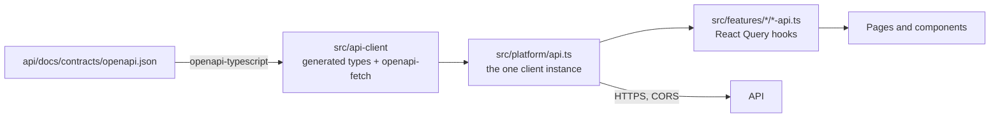

# Web architecture



One React single-page app built with Vite. It reaches the API only through the typed client generated from the
backend contract. Every feature is specified before it is built: the [feature specifications (SDD)](specs/README.md)
hold the scenarios, the design and the tasks of each one.

## Folders

```
src/
  main.tsx        entry: router and providers
  app/
    root/         routes and providers (theme, React Query)
    theme/        palette, theme, light/dark/system switch (docs/design.md)
    shell/        header, side menu, bottom bar, the list of sections
  api-client/     generated/ types (never edited), client/ createApiClient, apiCall, ApiError, newIdempotencyKey
  platform/       the API client instance (VITE_API_URL), the query client and each backend module's query key
                  prefix (query-keys.ts)
  features/
    home/         Главная: the section summaries and their switcher, the placeholder for sections not built yet
    status/       API and database status page
    expenses/     the «Бюджет» section, the Expenses module (below)
    <area>/       one folder per backend module: shopping, todos, gifts
```

A feature folder holds its page components, its `<area>-api.ts` with React Query hooks, and tests next to the code.
When a feature grows past six files it splits by meaning (`list/`, `editor/`, `data/`). A component stays within 150
lines and any other module within 200 ([rules](rules.md#structure)); `npm run architecture:structure` checks the
folders, the file rules and the import boundaries in CI ([rules and their checks](rules.md#rules-and-their-checks)).

## Routes

| Path                            | Page                                                                                                    | Feature                  |
| ------------------------------- | ------------------------------------------------------------------------------------------------------- | ------------------------ |
| `/`                             | Главная, the dashboard                                                                                  | `home`                   |
| `/expenses`                     | Бюджет › Расходы: the month's (or a period's) expenses, category and «Кто» filters, add / edit / delete | `expenses/expense-list`  |
| `/expenses/incomes`             | Доходы: the month's incomes, «Кто» filter, add / edit / delete                                          | `expenses/income-list`   |
| `/expenses/savings`             | Копилка: the balance now and the goal ring, the month's movements with add / edit / delete, the months  | `expenses/savings-page`  |
| `/expenses/forecast`            | Прогноз: the month's planned expenses and «Запланировано», add / edit / delete, «Записать как расход»   | `expenses/forecast-page` |
| `/expenses/settings`            | Настройки (the gear next to the tabs): monthly limit, savings goal, spending limits                     | `expenses/settings-page` |
| `/shopping`, `/todos`, `/gifts` | «Раздел скоро появится» placeholder                                                                     | `home/ComingSoonPage`    |
| `/status`                       | Состояние: API and database status                                                                      | `status`                 |

Unknown paths redirect to `/`. Routes are declared in `src/app/root/App.tsx`.

## Home (`src/features/home`)

The home page shows one section's summary at a time, picked with a switcher
([ADR 0008](decisions/0008-home-page-as-a-registry-of-section-summaries.md)).

```
home/
  page/              HomePage (title, switcher, the open summary, the «Состояние» link for phones), the summary
                     registry (summary-sections.ts), ?s= in the URL, the «Раздел скоро появится» placeholder
  expenses-summary/
    data/            summary-api.ts (GET /api/expenses/summary), the month and ?year=&month=, amounts and the goal
                     percent (money.ts), labels, figure-lines.ts (the empty month, the «Вне лимитов» line, the
                     «Прогноз» lines)
    overview/        ExpensesSummary (month picker, «Открыть расходы», loading and error), SummaryContent (which
                     cards show), the empty month, the month picker
    figures/         the four figure cards (KpiCards, one KpiCard), «Прогноз», «Кто сколько потратил» and «Топ-5
                     категорий» (SpendingCards, AmountsCard), and card-lines.ts (their captions and lines)
    limits/          «Лимиты»: the card, LimitTable (computer), LimitList (phone), the carry-over and plan notes
                     under a row, the fill bar, the rows with «ИТОГО»
```

- `summary-sections.ts` lists every section with its summary component, or `null` while it has none: the switcher
  shows those disabled, marked «скоро». A new summary is its own folder here plus one line in the list. A missing or
  unknown `?s=` opens the first built summary.
- «Бюджет» is the old sheet's «Сводка»: Доходы (by person), Расходы (against the monthly limit, and «Вне лимитов: N
  трат на S» only when the month has expenses marked «Не в лимиты»), Итог месяца (after the jar), Копилка (against
  the goal); the limits, quarterly ones marked «(квартал)», with «ИТОГО» = the expenses that count against the limits
  plus the overspend carried in, against the monthly limit, and what may still be spent per day; under a row
  «перенос N» (carried in), «→ след. мес. N» (moves on) and «план N» (planned), each only when it is not zero;
  «Прогноз» (expected expenses, planned, the expected result, what stays of the monthly limit, «Открыть план»); who
  spent what; the top five categories. Its query key is `['expenses', 'summary', month]`, under the Expenses prefix
  (`moduleKeys.expenses` in `src/platform/query-keys.ts`), so every write on the Бюджет pages refreshes it
  ([ADR 0009](decisions/0009-writes-refresh-their-backend-module.md)). «Открыть расходы» opens the same month. A month
  with no entries and no plans shows the empty state.
- The summary keeps its own labels and formatters: features never import each other. Rules both features show keep
  one definition per side with the same test cases: the savings goal percent is rounded down on both «Копилка» cards
  (`goalPercentOf` here, `goalPercent` in `expenses/savings-goal/goal-progress.ts`), so 100 % means the goal is reached;
  the month helpers and the month picker are copies of the `expenses` ones.

## Expenses (`src/features/expenses`)

The «Бюджет» section (named «Расходы» before; the URLs stay `/expenses`): pages of the old expenses Google Sheet, as
tabs of one section ([ADR 0006](decisions/0006-section-pages-as-tabs-with-state-in-the-url.md)).

```
expenses/
  data/             expenses-api.ts and savings-api.ts (React Query reads), writes-api.ts (save / delete hooks of
                    expenses, incomes and savings movements), formatting (signed amounts too), Russian enum labels,
                    months
  write-data/       what every write shares: write-hooks-api.ts (the Writer shape, useSave / useChange / useRemove,
                    If-Match, the Idempotency-Key hook, the module refresh) and write-errors-api.ts (Russian text of
                    a failed write)
  section/          ExpensesSection (title, month picker, tabs and the «Настройки» gear, <Outlet />), the list of pages
  url-state/        the month (?year=&month=), the Расходы period (?from=&to=, its checks) and filters
                    (?category=&payer=, ?person=) in the URL
  month-view/       parts every month page uses: the toolbar row with the add button, the paged list card
                    (loading/empty/error, the rows, «Показать ещё»), the filter select
  entry-editing/    form logic shared by every entry: field checks, default date, the open-dialog state, useEntryForm
  entry-dialogs/    the add / edit dialog frame, the delete confirmation, the row «⋮» menu (with an optional step of
                    its own), amount, person and category fields
  expense-list/     «Расходы» page: which expenses it shows (use-shown-expenses.ts: month or period, filters, from the
                    URL), phone list, computer table, the «вне лимитов» chip
  expense-filters/  the row above the expenses: category and «Кто» filters, «Период», «Добавить расход»
  expense-editing/  the expense form (values ↔ request, «Не в лимиты») and its dialogs
  income-list/      «Доходы» page: filter, «Добавить доход», phone list, computer table
  income-editing/   the income form and its dialogs
  savings-page/     «Копилка» page: balance card, «По месяцам» and its rows, signed amounts
  savings-movements/ «Движения за месяц»: the open month's movements (phone list, computer table) with add / edit /
                    delete
  savings-editing/  the savings form (direction + positive amount → signed request) and its dialogs
  savings-goal/     «План копилки» card on Копилка: percent ring, now / goal / left, or a link to set a goal
  budget-data/      budget-api.ts (the budget read) and budget-writes-api.ts (settings and spending limit writes)
  settings-page/    «Настройки» page: the monthly limit and savings goal form, the spending limits list
  limit-editing/    the spending limit form (name, month / quarter, amount, categories) and its dialogs
  planned-data/     planned-api.ts (the month's plans, «Запланировано») and planned-writes-api.ts (plan writes and
                    «Записать как расход»)
  forecast-page/    «Прогноз» page: «Запланировано» (PlannedTotal), «Добавить план», phone list, computer table
  planned-editing/  the plan form (name, category, who, amount), the record form (date, payment, comment) and their
                    dialogs
```

- The month defaults to the current one; the arrows change `?year=&month=`, so a link opens the same month.
- «Расходы» can show any days instead of the month: «Период» adds `?from=&to=` (the open month's first and last day to
  start), hides the month picker and sends `from`/`to` instead of `year`/`month`; the filters work with it and «К
  месяцу» drops it. Both dates set, «с» not after «по» and at most 366 days are checked before anything loads.
  Switching tabs keeps only the month, so Доходы and Копилка stay month-based.
- Lists load 50 rows a page with `useInfiniteQuery` and «Показать ещё». The Расходы and Доходы pages show no month
  total; an overall summary will be a page of its own.
- Expenses, incomes and savings movements are added, changed and deleted in dialogs
  ([ADR 0007](decisions/0007-editing-in-dialogs-with-idempotency-and-versions.md)): a create sends an
  `Idempotency-Key` (one per opened form, kept while the same data is retried), an edit sends the row's `version` in
  `If-Match`, and a delete asks first. A success invalidates every query of the Expenses module
  (`moduleKeys.expenses`, `['expenses']`): the lists, the budget, the plans and the home summary
  ([ADR 0009](decisions/0009-writes-refresh-their-backend-module.md)); a 404 or `expenses.changed_meanwhile` reloads them
  too. Only the queries on screen refetch; the rest refetch when they are shown again.
- «Настройки» (`/expenses/settings`, no month picker, not a tab) reads `/api/expenses/budget`. The monthly limit and
  the savings goal are one form saved with the budget's `version` in `If-Match` (empty = 0 = none); spending limits
  are added (`Idempotency-Key`), changed (`If-Match`) and deleted in dialogs like entries. Like every write, a budget
  write invalidates the module's queries, so the home summary's limits and goal follow. The settings are changed
  through `useChange` (a write with no create or delete), bound to the budget's version.
- An expense marked «Не в лимиты» counts in the month's totals but in no limit and no carry-over; the lists mark it
  with a small «вне лимитов» chip.
- «Прогноз» (`/expenses/forecast`) lists the open month's planned expenses (`/api/expenses/planned?year=&month=`) with
  their total «Запланировано». Plans are added (`Idempotency-Key`), changed (`If-Match`) and deleted in dialogs like
  entries and refresh the module's queries. «Записать как расход» in a plan's «⋮» menu asks for the date
  (today), the payment and a comment and posts `/api/expenses/planned/{id}/record` with the plan's version in
  `If-Match`: the plan becomes an expense and is gone; like every write it refreshes the module's queries.
- «Копилка» also shows «План копилки»: the balance today against the budget's savings goal.
- «Копилка» shows the jar's balance today (`/api/expenses/savings/months`), the open month's movements with its
  start / in / out / end figures (`/api/expenses/savings`), and every month; a month in that list opens it.
- Below `md` a list is a compact MUI `List`; from `md` it is a `Table` (`useMediaQuery`).
- A new page (Обзор, Лимиты, Платежи, По месяцам, Категории) is an entry in
  `section/expenses-pages.ts`, a nested route in `App.tsx` and its own folder.

## API client (`src/api-client`)

- `generated/api.ts`: types generated from the backend contract. Never edited by hand.
- `createApiClient({ baseUrl, fetch })`: an `openapi-fetch` client that sends cookies.
- `apiCall(request)`: unwraps a response or throws `ApiError` with the HTTP status, the problem `code` and field
  errors keyed by camelCase field name, ready for a form.
- `newIdempotencyKey()`: a key for requests that must not run twice.
- `Schema<'SystemStatus'>`: a named schema type, so components can type their props from the contract.

## App

- Server state lives in React Query. Every read of a backend module starts its query key with the module's prefix
  (`src/platform/query-keys.ts`), and every write invalidates that whole prefix, so a page or summary of another
  feature that shows the same module's data refreshes too ([ADR 0009](decisions/0009-writes-refresh-their-backend-module.md)).
  Failures with a 4xx status are not retried.
- `index.html` has `noindex` and `robots.txt` disallows everything.
- `public/staticwebapp.config.json` sends unknown paths to `index.html` on Azure Static Web Apps; other static hosts
  ignore it.
- UI text is Russian; screens are designed for a phone first. Look, theme and layout: [design rules](design.md).
