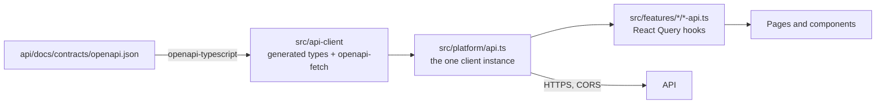
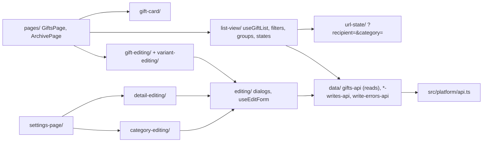

# Web architecture



One React single-page app built with Vite. It reaches the API only through the typed client generated from the
backend contract.

## Folders

```
src/
  main.tsx        entry: router and providers
  app/
    root/         routes and providers (theme, React Query)
    theme/        palette, theme, light/dark/system switch (docs/design.md)
    shell/        header, side menu, bottom bar, the list of sections
  api-client/     generated/ types (never edited), client/ createApiClient, apiCall, ApiError, newIdempotencyKey
  platform/       the API client instance (VITE_API_URL) and the query client
  features/
    home/         Главная: the section summaries and their switcher, the placeholder for sections not built yet
    status/       API and database status page
    expenses/     the Expenses section (below)
    gifts/        the Gifts section (below)
    <area>/       one folder per backend module: shopping, todos
```

A feature folder holds its page components, its `<area>-api.ts` with React Query hooks, and tests next to the code.
When a feature grows past six files it splits by meaning (`list/`, `editor/`, `data/`).

## Routes

| Path                  | Page                                                                                                    | Feature                  |
| --------------------- | ------------------------------------------------------------------------------------------------------- | ------------------------ |
| `/`                   | Главная, the dashboard                                                                                  | `home`                   |
| `/expenses`           | Расходы: the month's (or a period's) expenses, category and «Кто» filters, add / edit / delete          | `expenses/expense-list`  |
| `/expenses/incomes`   | Доходы: the month's incomes, «Кто» filter, add / edit / delete                                          | `expenses/income-list`   |
| `/expenses/savings`   | Копилка: the balance now and the goal ring, the month's movements with add / edit / delete, the months  | `expenses/savings-page`  |
| `/expenses/settings`  | Настройки (the gear next to the tabs): monthly limit, savings goal, spending limits                     | `expenses/settings-page` |
| `/gifts`              | Список: wanted gifts grouped by person, recipient and category filters, add / edit / delete, «Подарено» | `gifts/pages`            |
| `/gifts/archive`      | Подаренные: gifted and dropped gifts, «Вернуть в список»                                                | `gifts/pages`            |
| `/gifts/settings`     | Настройки (the gear next to the tabs): «Нюансы» and categories                                          | `gifts/settings-page`    |
| `/shopping`, `/todos` | «Раздел скоро появится» placeholder                                                                     | `home/ComingSoonPage`    |
| `/status`             | Состояние: API and database status                                                                      | `status`                 |

Unknown paths redirect to `/`. Routes are declared in `src/app/root/App.tsx`.

## Home (`src/features/home`)

The home page shows one section's summary at a time, picked with a switcher
([ADR 0008](decisions/0008-home-page-as-a-registry-of-section-summaries.md)).

```
home/
  page/              HomePage (title, switcher, the open summary, the «Состояние» link for phones), the summary
                     registry (summary-sections.ts), ?s= in the URL, the «Раздел скоро появится» placeholder
  expenses-summary/
    data/            summary-api.ts (GET /api/expenses/summary), the month and ?year=&month=, amounts, labels,
                     the «Лимиты» rows with «ИТОГО»
    view/            ExpensesSummary (month picker, states), the four figure cards, «Лимиты» (phone list, computer
                     table), «Кто сколько потратил» and «Топ-5 категорий»
  gifts-summary/
    data/            summary-api.ts (GET /api/gifts/summary, key ['gifts', 'summary']), recipient labels, sums and dates
    view/            GiftsSummary (states, «Открыть подарки»), a figure card per person and «Всего», «🔥 Очень хочу»,
                     «Ближайшие поводы», «Нюансы» read-only with «Изменить» → /gifts/settings
```

- `summary-sections.ts` lists every section with its summary component, or `null` while it has none: the switcher
  shows those disabled, marked «скоро». A new summary is its own folder here plus one line in the list. A missing or
  unknown `?s=` opens the first built summary.
- «Расходы» is the old sheet's «Сводка» without its plan block: Доходы (by person), Расходы (against the monthly
  limit), Итог месяца (after the jar), Копилка (against the goal); the limits, quarterly ones marked «(квартал)», with
  «ИТОГО» = all expenses against the monthly limit and what may still be spent per day; who spent what; the top five
  categories. Its query key is `['expenses', 'summary', month]`. «Открыть расходы» opens the same month.
- The summary keeps its own labels and formatters: features never import each other.

## Expenses (`src/features/expenses`)

Pages of the old expenses Google Sheet, as tabs of one section ([ADR 0006](decisions/0006-section-pages-as-tabs-with-state-in-the-url.md)).

```
expenses/
  data/             expenses-api.ts and savings-api.ts (React Query reads), writes-api.ts (save / delete mutations,
                    the Idempotency-Key hook, Russian text of a failed write), formatting (signed amounts too),
                    Russian enum labels, months
  section/          ExpensesSection (title, month picker, tabs and the «Настройки» gear, <Outlet />), the list of pages
  url-state/        the month (?year=&month=), the Расходы period (?from=&to=, its checks) and filters
                    (?category=&payer=, ?person=) in the URL
  month-view/       parts every month page uses: filter select, loading/empty/error, «Показать ещё»
  entry-editing/    form logic shared by every entry: field checks, default date, the open-dialog state, useEntryForm
  entry-dialogs/    the add / edit dialog frame, the delete confirmation, the row «⋮» menu, amount and person fields
  expense-list/     «Расходы» page: filters, «Добавить расход», phone list, computer table
  expense-editing/  the expense form (values ↔ request) and its dialogs
  income-list/      «Доходы» page: filter, «Добавить доход», phone list, computer table
  income-editing/   the income form and its dialogs
  savings-page/     «Копилка» page: balance card, movements (phone list, computer table), «По месяцам», signed amounts
  savings-editing/  the savings form (direction + positive amount → signed request) and its dialogs
  savings-goal/     «План копилки» card on Копилка: percent ring, now / goal / left, or a link to set a goal
  budget-data/      budget-api.ts (the budget read) and budget-writes-api.ts (settings and spending limit writes)
  settings-page/    «Настройки» page: the monthly limit and savings goal form, the spending limits list
  limit-editing/    the spending limit form (name, month / quarter, amount, categories) and its dialogs
```

- The month defaults to the current one; the arrows change `?year=&month=`, so a link opens the same month.
- «Расходы» can show any days instead of the month: «Период» adds `?from=&to=` (the open month's first and last day to
  start), hides the month picker and sends `from`/`to` instead of `year`/`month`; the filters work with it and «К
  месяцу» drops it. Both dates set, «с» not after «по» and at most 366 days are checked before anything loads.
  Switching tabs keeps only the month, so Доходы and Копилка stay month-based.
- Lists load 50 rows a page with `useInfiniteQuery` and «Показать ещё». The Расходы and Доходы pages show no month
  total; an overall summary will be a page of its own.
- Expenses, incomes and savings movements are added, changed and deleted in dialogs
  ([ADR 0007](decisions/0007-editing-in-dialogs-with-idempotency-and-versions.md)): a create sends an
  `Idempotency-Key` (one per opened form, kept while the same data is retried), an edit sends the row's `version` in
  `If-Match`, and a delete asks first. A success invalidates the kind's queries (`['expenses', 'list']`,
  `['expenses', 'incomes']`, `['expenses', 'savings']`); a 404 or `expenses.changed_meanwhile` reloads them too.
- «Настройки» (`/expenses/settings`, no month picker, not a tab) reads `/api/expenses/budget`. The monthly limit and
  the savings goal are one form saved with the budget's `version` in `If-Match` (empty = 0 = none); spending limits
  are added (`Idempotency-Key`), changed (`If-Match`) and deleted in dialogs like entries. Every budget write
  invalidates `['expenses', 'budget']`.
- «Копилка» also shows «План копилки»: the balance today against the budget's savings goal.
- «Копилка» shows the jar's balance today (`/api/expenses/savings/months`), the open month's movements with its
  start / in / out / end figures (`/api/expenses/savings`), and every month; a month in that list opens it.
- Below `md` a list is a compact MUI `List`; from `md` it is a `Table` (`useMediaQuery`).
- A new page (Обзор, Лимиты, План, Платежи, По месяцам, Категории) is an entry in
  `section/expenses-pages.ts`, a nested route in `App.tsx` and its own folder.

## Gifts (`src/features/gifts`)

The old «🎁 Список подарков» sheet as a section with tabs ([ADR 0006](decisions/0006-section-pages-as-tabs-with-state-in-the-url.md)):
«Список», «Подаренные», and «Настройки» behind the gear. Specification:
[specs/gifts/001-gifts-section](specs/gifts/001-gifts-section/README.md).



```
gifts/
  data/              gifts-api.ts (types from the contract, reads, query keys), writes-api.ts (Writer, useSave/useRemove,
                     useIdempotencyKey), gift-writes-api.ts (gift and status), settings-writes-api.ts (categories,
                     «нюансы»), write-errors-api.ts (Russian text of a failed write, isStale)
  display/           Russian labels of recipients, priorities and statuses; price, date, variant and plural formatting
  url-state/         ?recipient=&category= (unknown values ignored), filtering and grouping in memory
  section/           GiftsSection (title, tabs, gear, <Outlet />), the list of pages
  editing/           EditDialog, DeleteDialog, RowActions («⋮» with extra items), useEditForm, useEditorState, field checks
  gift-card/         GiftCard: name and price, chips, notes, variants (VariantLinks), CardActions (link, status, «⋮»)
  list-view/         useGiftList (the controller of a tab), GiftFilters, GiftGroups, ListStatus, StatusSnackbar
  pages/             GiftsPage («Список»), ArchivePage («Подаренные»)
  gift-editing/      GiftEditor, GiftDialog (GiftFields, OccasionFields), gift-form.ts (values ↔ GiftRequest, checks)
  variant-editing/   VariantsEditor (up to 20 rows), VariantRow, PriceField
  settings-page/     GiftSettingsPage, SettingsCard, DetailsCard («Нюансы» by person), CategoriesCard
  detail-editing/    the «нюанс» form and its dialogs
  category-editing/  the category form and its dialogs
```

- The API filters only by `archived`; the person and category filters run in memory over the tab's one list (a few
  hundred gifts at most), so a filter change sends no request. Without a person filter «Список» groups by person.
- Writes follow [ADR 0007](decisions/0007-editing-in-dialogs-with-idempotency-and-versions.md): creates send an
  `Idempotency-Key`, gift, status and «нюанс» edits send the `version` in `If-Match` (categories have none), a 409
  `gifts.changed_meanwhile`, a 412 or a 404 reload the list. A gift write invalidates `['gifts', 'items']` and
  `['gifts', 'summary']`; a category write `['gifts', 'categories']` and the items; a «нюанс» write
  `['gifts', 'details']` and the summary.
- «Подарено» sends `{ status: 'Gifted', giftedOn: null }` (the server takes today in Kyiv); «Не актуально» and
  «Вернуть в список» send `Dropped` and `Wanted`. The edit dialog never changes the status.
- The editing frame is a copy of the Expenses one adapted to the `gifts.*` codes, because features never import each
  other.

### Tests

`cd web && npx vitest run src/features/gifts src/features/home/gifts-summary`: unit tests of `display/formatting`,
`url-state/gift-filters`, `editing/field-checks`, `data/write-errors-api`, `gift-editing/gift-form`,
`detail-editing/detail-form`, `category-editing/category-form`; component tests of `gift-card/GiftCard`,
`editing/EditDialog` (and `DeleteDialog`), `section/GiftsSection`; page tests of `pages/GiftsPage`,
`pages/ArchivePage`, `settings-page/GiftSettingsPage` and `home/gifts-summary/view/GiftsSummary` with a stubbed
`fetch`.

## API client (`src/api-client`)

- `generated/api.ts`: types generated from the backend contract. Never edited by hand.
- `createApiClient({ baseUrl, fetch })`: an `openapi-fetch` client that sends cookies.
- `apiCall(request)`: unwraps a response or throws `ApiError` with the HTTP status, the problem `code` and field
  errors keyed by camelCase field name, ready for a form.
- `newIdempotencyKey()`: a key for requests that must not run twice.
- `Schema<'SystemStatus'>`: a named schema type, so components can type their props from the contract.

## App

- Server state lives in React Query; mutations invalidate the lists they change. Failures with a 4xx status are not
  retried.
- `index.html` has `noindex` and `robots.txt` disallows everything.
- `public/staticwebapp.config.json` sends unknown paths to `index.html` on Azure Static Web Apps; other static hosts
  ignore it.
- UI text is Russian; screens are designed for a phone first. Look, theme and layout: [design rules](design.md).
