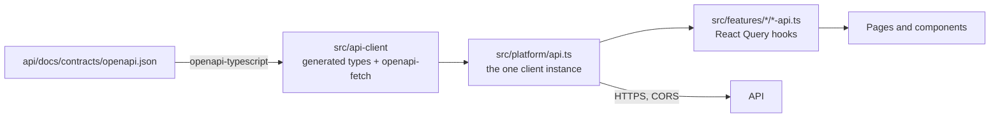

# Web architecture



One React single-page app built with Vite. It reaches the API only through the typed client generated from the
backend contract.

## Folders

```
src/
  main.tsx        entry: router and providers
  app/            layout, routes, providers (theme, React Query), theme
  api-client/     generated/ types (never edited), client/ createApiClient, apiCall, ApiError, newIdempotencyKey
  platform/       the API client instance (VITE_API_URL) and the query client
  features/
    status/       API and database status page (the first page until real features arrive)
    <area>/       one folder per backend module: expenses, shopping, todos, gifts
```

A feature folder holds its page components, its `<area>-api.ts` with React Query hooks, and tests next to the code.
When a feature grows past six files it splits by meaning (`list/`, `editor/`, `data/`).

## API client (`src/api-client`)

- `generated/api.ts`: types generated from the backend contract. Never edited by hand.
- `createApiClient({ baseUrl, fetch })`: an `openapi-fetch` client that sends cookies.
- `apiCall(request)`: unwraps a response or throws `ApiError` with the HTTP status, the problem `code` and field
  errors keyed by camelCase field name, ready for a form.
- `newIdempotencyKey()`: a key for requests that must not run twice.
- `Schema<'SystemStatus'>`: a named schema type, so components can type their props from the contract.

## App

- Server state lives in React Query; mutations invalidate the lists they change. Failures with a 4xx status are not
  retried.
- `index.html` has `noindex` and `robots.txt` disallows everything.
- `public/staticwebapp.config.json` sends unknown paths to `index.html` on Azure Static Web Apps; other static hosts
  ignore it.
- UI text is Russian; screens are designed for a phone first.
