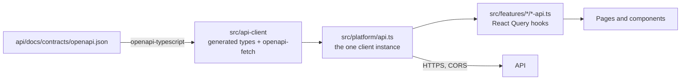

# Web architecture



One React single-page app built with Vite. It reaches the API only through the typed client generated from the
backend contract.

## Folders

```
src/
  main.tsx        entry: router and providers
  app/
    root/         routes and providers (theme, React Query)
    theme/        palette, theme, light/dark/system switch (docs/design.md)
    shell/        header, side menu, bottom bar, the list of sections
  api-client/     generated/ types (never edited), client/ createApiClient, apiCall, ApiError, newIdempotencyKey
  platform/       the API client instance (VITE_API_URL) and the query client
  features/
    home/         the dashboard and the placeholder for sections not built yet
    status/       API and database status page
    expenses/     the Expenses section (below)
    <area>/       one folder per backend module: shopping, todos, gifts
```

A feature folder holds its page components, its `<area>-api.ts` with React Query hooks, and tests next to the code.
When a feature grows past six files it splits by meaning (`list/`, `editor/`, `data/`).

## Routes

| Path                            | Page                                                             | Feature                 |
| ------------------------------- | ---------------------------------------------------------------- | ----------------------- |
| `/`                             | Главная, the dashboard                                           | `home`                  |
| `/expenses`                     | Расходы: the month's expenses, total, category and «Кто» filters | `expenses/expense-list` |
| `/expenses/incomes`             | Доходы: the month's incomes, total, «Кто» filter                 | `expenses/income-list`  |
| `/shopping`, `/todos`, `/gifts` | «Раздел скоро появится» placeholder                              | `home/ComingSoonPage`   |
| `/status`                       | Состояние: API and database status                               | `status`                |

Unknown paths redirect to `/`. Routes are declared in `src/app/root/App.tsx`.

## Expenses (`src/features/expenses`)

Pages of the old expenses Google Sheet, as tabs of one section ([ADR 0006](decisions/0006-section-pages-as-tabs-with-state-in-the-url.md)).

```
expenses/
  data/           expenses-api.ts (React Query hooks), month and amount formatting, Russian enum labels
  section/        ExpensesSection (title, month picker, tabs, <Outlet />), the list of pages
  url-state/      the month (?year=&month=) and filters (?category=&payer=, ?person=) in the URL
  month-view/     parts every month page uses: total card, filter select, loading/empty/error, «Показать ещё»
  expense-list/   «Расходы» page: filters, phone list, computer table
  income-list/    «Доходы» page: filter, phone list, computer table
```

- The month defaults to the current one; the arrows change `?year=&month=`, so a link opens the same month.
- Lists load 50 rows a page with `useInfiniteQuery` and «Показать ещё»; the total comes from the API for the whole
  filtered month, not the loaded rows.
- Below `md` a list is a compact MUI `List`; from `md` it is a `Table` (`useMediaQuery`).
- A new page (Обзор, Лимиты, План, Платежи, По месяцам, Копилка, Категории) is an entry in
  `section/expenses-pages.ts`, a nested route in `App.tsx` and its own folder.

## API client (`src/api-client`)

- `generated/api.ts`: types generated from the backend contract. Never edited by hand.
- `createApiClient({ baseUrl, fetch })`: an `openapi-fetch` client that sends cookies.
- `apiCall(request)`: unwraps a response or throws `ApiError` with the HTTP status, the problem `code` and field
  errors keyed by camelCase field name, ready for a form.
- `newIdempotencyKey()`: a key for requests that must not run twice.
- `Schema<'SystemStatus'>`: a named schema type, so components can type their props from the contract.

## App

- Server state lives in React Query; mutations invalidate the lists they change. Failures with a 4xx status are not
  retried.
- `index.html` has `noindex` and `robots.txt` disallows everything.
- `public/staticwebapp.config.json` sends unknown paths to `index.html` on Azure Static Web Apps; other static hosts
  ignore it.
- UI text is Russian; screens are designed for a phone first. Look, theme and layout: [design rules](design.md).
